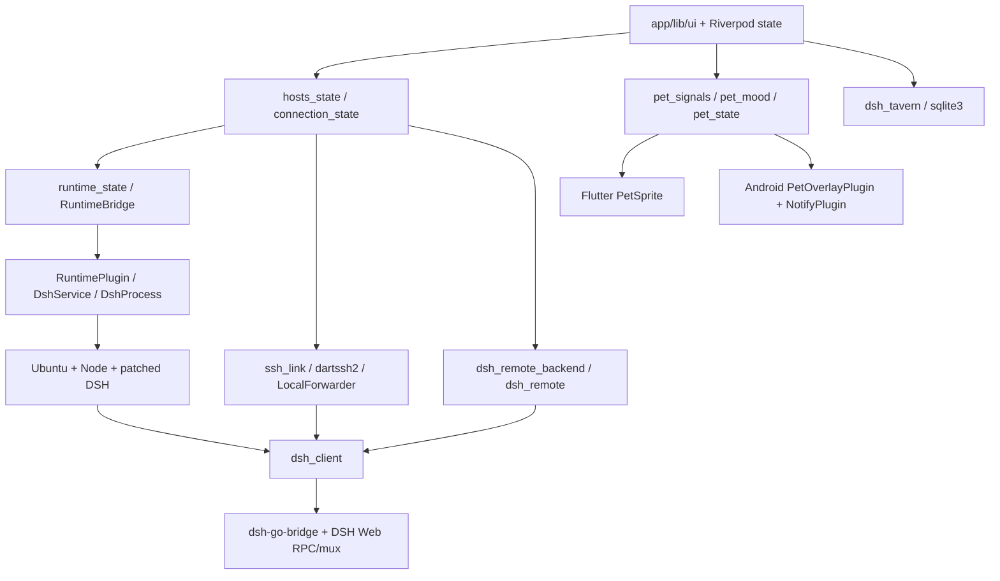

# dsh-Go iOS 架构审计与后续实施计划

> 本次仅第一阶段；第二至第九阶段均未实施。报告已按审计进度分批保存。

## 执行摘要

- **已核实**：基线 `288234ae52fdfcfc2b0a0388763c371d0b09ea7d`；没有 iOS 工程。Flutter 配置为 3.47.7，App Dart 约束 ^3.13.5。
- **已核实的关键阻塞**：`runtime/locks/dsh-0.2.2-rc.1/package-lock.json` 中 `node_modules/@deepseek-ai/dsh.engines.node` 为 **>=24.9.0**；原始目标 Node 22 不满足当前引擎声明。必须先验证 ShellBox + Node 24，或另行审计其他 DSH 版本的协议/补丁兼容性，不能静默降级。
- **仅静态检查**：Flutter UI、dsh_client、SSH/Remote、Dart 桌宠 reducer 可优先复用；Android 原生运行时、手机操控、悬浮窗、保活和 APK 安装不能直接迁移。
- **未核实/阻塞**：ShellBox 固定版本/许可正文/DSH 运行，全部依赖实际 iOS 编译与最终许可收录，macOS 工具链、签名、真机。Deepy/鲸娘修改版发行还受 ASSETS.md 授权限制。
- **计划**：先做 iOS 远程客户端闭环，同时验证本地引擎可行性；再双模式、ActivityKit、系统体验、签名构建与完整验收。本次只生成本报告，不实施、不提交。


## 范围、证据与状态

- 审计日期：2026-11-12；本地基线 `288234ae`，分支 `feature/ios-shellbox-dynamic-island`，origin 为 `https://github.com/wedfkewn/dsh-go.git`。开始时工作树干净。
- 用户只授权写本文件；未创建分支、未 fetch（避免写 Git 元数据）、未安装依赖、未生成工程、未 commit/push。远端最新状态未核实。
- 已读取 `AGENTS.md`、`README.md`、`CONTRIBUTING.md`、`docs/architecture.md`、`ASSETS.md`、`THIRD_PARTY_NOTICES.md` 及审计技能 `.agents/skills/audit/SKILL.md`。
- **已核实**：实际文件、配置或符号存在，附路径；不代表执行成功。**仅静态检查**：调用链或移植风险判断，未编译/运行。**未核实**：缺证据、外部兼容性或实际测试未完成。
- 递归清点（排除 build、.dart_tool、node_modules）：`app/` 4731 文件、`packages/` 743、`runtime/` 619、`sdk/` 80、`tooling/` 33、`.github/workflows/` 3。清点不等于逐文件完整语义审查；以下按入口追踪关键路径。

## 1. 工程与版本

**已核实**：根目录不存在 `pubspec.yaml`，实际 Flutter 工程清单是 `app/pubspec.yaml`；App `1.0.15+1`，Dart 约束 `^3.13.5`。`tooling/setup-toolchain.sh` 与 `.github/workflows/ci.yml`、`goldens.yml` 指定 Flutter `3.47.7`。这属于配置版本，当前机器 SDK 实际版本未核实（PATH 无 flutter/dart）。

**已核实**：`packages/dsh_client/pubspec.yaml`、`packages/dsh_remote/pubspec.yaml`、`packages/dsh_tavern/pubspec.yaml` 要求 Dart `^3.11.0`；本地修改的 `packages/dartssh2/pubspec.yaml` 为 `4.1.0`、Dart `>=3.0.0 <4.0.0`。`sdk/plugin-kit/package.json` 为私有 MIT 包 `@dsh-go/plugin-kit` `0.1.0`，Node `>=22.19`，TypeScript 开发依赖 `5.9.3`，零运行时依赖。

**已核实**：`runtime/build-runtime.sh` 默认 DSH `0.2.2-rc.1`、Node `24.22.1`、pnpm `11.28.5`、Ubuntu Base `24.04.5`。原始目标要求 Node 22，与当前 Android 默认不同，后续必须单独选择并验证，不能直接沿用。

**已核实**：`app/` 中没有 `ios/`。当前没有可审计的 iOS Runner、Podfile、Xcode 工程或 Widget Extension；不能声称已有 iOS 工程完成。

## 2. 许可与第一批阻塞项

**已核实**：`LICENSE` 为 AGPL-3.0，`sdk/plugin-kit/LICENSE` 为 MIT。`ASSETS.md` 明确 Deepy、鲸娘及品牌素材不在 AGPL 授权内：可用于构建、测试和运行本仓库；修改版再发布要求更换名称和素材。保留原形象的 IPA 发行需另行取得相应授权，代码开源许可不能替代美术授权。

**已核实**：`THIRD_PARTY_NOTICES.md` 登记 PiPilot MIT、DS Bot Apache-2.0、DSH/DSH Remote MIT、Phase 经作者许可、JetBrains Mono OFL 等；其中 npm 传递依赖段仍指 `dsh-0.2.1-rc.4`，而当前构建默认已为 `0.2.2-rc.1`，发行清单必须按实际 lock 和最终载荷重核。

**未核实/阻塞**：ShellBox 版本、许可、Node/V8 与系统调用兼容性；macOS/Xcode、Apple 签名身份、Provisioning Profile、iPhone/iPad 真机；iOS 依赖实际构建与最终第三方通知收录。当前环境 `Linux x86_64`，PATH 未找到 flutter、dart、xcodebuild、pod、meson、ninja；未运行 iOS 构建或设备测试。

## 3. 模块依赖与 Android 原生边界

下图为**仅静态检查**所得调用关系，节点均有下列实际文件支撑：



**已核实**：`app/lib/main.dart` 初始化语言、开屏、许可证，再运行 `ProviderScope(child: DshApp())`；`app/lib/app.dart` 为 App 入口。UI、状态、纯 Dart 客户端分离，但不能仅以 Dart 实现断言可在 iOS 正常运行。`packages/dsh_tavern/` 是不能遗漏的第四业务包，依赖 sqlite3/native assets，不是 DSH Linux 环境的一部分。

**已核实**：Android 原生前缀为 `app/android/app/src/main/kotlin/io/github/ccch1mneyyy/dsh_app/`。`MainActivity.kt` 手工注册 Runtime、Phone、Notify、Files、Links、Update、Voice、Share、Shortcuts、Diagnostics、Media、MediaVideo、LauncherIcon、DynamicColor、Performance、PetOverlay、Islands、NativeMedia、NativeFiles、WebFiles、Launch、LaunchClip、PictureShortcut、Usage、CompanionVoice、CompanionWidget 插件。它缓存 FlutterEngine，`shouldDestroyEngineWithHost()` 返回 false；这些生命周期假设不能搬到 iOS。

**已核实**：`app/android/app/build.gradle.kts` 为 minSdk 26、targetSdk 28、Java 17，arm64/x64 两 flavor；runtime assets 与 jniLibs 按 ABI 注入，`useLegacyPackaging = true` 将 Linux 启动器作为 `lib*.so` 解压到 nativeLibraryDir。其 ML Kit OCR、Shizuku、ADB、Conscrypt、BouncyCastle、AndroidX WebKit、XZ 都是 Android 构建依赖，不是可直接链接到 iOS 的实现。

**仅静态检查/高风险**：`phone/` 的无障碍、Shizuku、自连 ADB、特权虚拟屏与跨 App 操作没有现成 iOS 实现；iOS 不能承诺全功能对等。Android 悬浮窗、APK 更新安装、保活服务、启动图标切换等必须按能力显示明确说明；保留 Android 原实现，不能全局删除功能来解决 iOS 编译。

## 4. 本地 Linux 安装、启动与更新

| 状态 | 环节 | 实际证据与移植含义 |
|---|---|---|
| 已核实 | 构建输入 | `runtime/build-runtime.sh` 下载 Ubuntu Base、Node Linux 归档、Termux PRoot 组件；`runtime/locks/ubuntu-noble-arm64.json`、`ubuntu-noble-amd64.json` 固定 deb；`runtime/locks/dsh-0.2.2-rc.1/package-lock.json` 固定 npm 树。 |
| 已核实 | 补丁与桥 | `runtime/lib/rtbuild.py` 组装 rootfs/启动清单；`runtime/patches/pins.json` 固定补丁；`runtime/bridge/dsh-go-bridge/package.json` 为 MIT `0.4.0`、Node >=20，提供宿主桥。补丁不是 iOS 补丁，必须逐项重验。 |
| 已核实 | 安装 | 原生 `app/android/app/src/main/kotlin/io/github/ccch1mneyyy/dsh_app/runtime/RuntimeInstaller.kt` 使用 `filesDir/runtime/rootfs`、`rootfs.version`，核对归档 SHA-256，解压到 staging；首次初始化与引擎升级不同，已有 rootfs 不能被无声覆盖。 |
| 已核实 | 启动 | 原生 `app/android/app/src/main/kotlin/io/github/ccch1mneyyy/dsh_app/runtime/DshProcess.kt` 扩展 manifest 的 `{ROOTFS}`、`{PORT}`、`{NATIVE_LIB_DIR}` 等占位，动态选择端口（不能把文档示例 3080 当固定值）。`runtime/lib/rtbuild.py` 定义 `--host 127.0.0.1 --port {PORT} --no-open`。 |
| 已核实 | 三条 Android 路线 | `app/android/app/src/main/kotlin/io/github/ccch1mneyyy/dsh_app/runtime/DirectLaunch.kt`、`app/android/app/src/main/kotlin/io/github/ccch1mneyyy/dsh_app/runtime/TawcrootLaunch.kt` 与 `DshProcess.kt`：默认 PRoot，另有可选 direct-glibc/tawcroot；安全恢复路径仍用 PRoot。`runtime/direct/` 为直接启动 Node 补偿层，`runtime/tawcroot/` 为另一启动器构建输入，均不能当作 ShellBox 实现。 |
| 仅静态检查 | 进程与后台 | 原生 `app/android/app/src/main/kotlin/io/github/ccch1mneyyy/dsh_app/runtime/DshService.kt` 管理前台服务，`DshProcess.kt` 管理进程、输出、端口与遗留进程清理。iOS 需改为 App 前台生命周期，挂起/终止后恢复，不能照搬前台服务/WakeLock。 |
| 仅静态检查 | 升级/重置 | `RuntimeInstaller.kt` 与 `docs/architecture.md` 的 engine.prepare/engine.upgrade/rootfs.version 事务语义，以及 Dart `RuntimeBridge.reset(keep: ...)`，需要在新文件系统语义下保留。不能把选择性保留当作完整备份。 |
| 未核实 | iOS 载荷 | Ubuntu/glibc 与 Alpine/musl 不同，Android 的 Node 二进制、sharp/libvips、其他原生 npm 模块与 PRoot 路径不能直接复用。尚未准备任何 Alpine rootfs、ShellBox 静态库或 iOS DSH 载荷。 |

**仅静态检查**：可复用版本与校验思路、DSH 桥协议、补丁输入和安装向导业务状态；解压/权限/guest 路径/进程控制需按 ShellBox 实际 API 重写。`app/lib/share_code/guest_fs.dart`、`app/lib/ui_config/ui_skill.dart`、`app/lib/voice/voice_model_assets.dart` 直接依赖 rootfs/`/root/.dsh` 布局。fakefs 若以数据库存元数据，直接用 Dart File 写 guest 文件可能绕开元数据，必须先选定 realfs/fakefs 并验证，不能只替换根目录字符串。

## 5. 平台通道契约

**已核实**：`app/lib/runtime/runtime_bridge.dart` 中实际类名是 `RuntimeBridge`，不是原始目标示例中的 `LocalRuntimeService`。后者及 `PetStateController` 均不能视为已有接口。运行时通道为 `dsh/runtime`、事件 `dsh/runtime/events`；实际不止旧架构文档列出的六个方法，还包括 managed skill 安装/取消、安全模式恢复、工作区恢复、直接/tawc 启动、存储、网络与厂商后台设置。iOS 应区分通用运行时契约和 Android 设置，不应把整组方法无差别实现成空返回。

**已核实**：状态含 phase、baseUrl、token、版本、安全模式、失败及启动诊断；日志有递增 seq、快照 throughSeq。事件含 status/progress/logs/notice。iOS 本地运行时应维持可观测错误与日志契约，凭据不可输出到日志。

下表由实际 Dart MethodChannel/EventChannel 字符串提取；均为**已核实（声明）**、**未核实（iOS 实现）**。同名通道可被多个调用方使用；Android 注册入口见 `MainActivity.kt` 和对应插件源码。

| 通道 | 类型 | Dart 源码（首个声明位置） |
|---|---|---|
| `dsh/app` | MethodChannel | `app/lib/performance/refresh_rate.dart` |
| `dsh/companion_voice` | MethodChannel | `app/lib/companion/companion_voice.dart` |
| `dsh/companion_widget` | MethodChannel | `app/lib/companion/companion_widget.dart` |
| `dsh/diagnostics` | MethodChannel | `app/lib/diagnostics/diagnostics_channel.dart` |
| `dsh/dynamic_color` | MethodChannel | `app/lib/state/appearance_state.dart` |
| `dsh/files` | MethodChannel | `app/lib/state/artifacts.dart` |
| `dsh/islands` | MethodChannel | `app/lib/ui/plugins/islands/island_platform.dart` |
| `dsh/launch` | MethodChannel | `app/lib/launch/launch_state.dart` |
| `dsh/launch_clip` | MethodChannel | `app/lib/launch/launch_video.dart` |
| `dsh/launcher_icon` | MethodChannel | `app/lib/state/app_icon_state.dart` |
| `dsh/links` | MethodChannel | `app/lib/links/app_links.dart` |
| `dsh/media` | MethodChannel | `app/lib/media/gallery.dart` |
| `dsh/media_video` | MethodChannel | `app/lib/media/video.dart` |
| `dsh/native-files` | MethodChannel | `app/lib/plugins/native/native_file_platform.dart` |
| `dsh/native-media` | MethodChannel | `app/lib/plugins/native/native_platform.dart` |
| `dsh/native-media/events` | EventChannel | `app/lib/plugins/native/native_platform.dart` |
| `dsh/notify` | MethodChannel | `app/lib/notify/notify_channel.dart` |
| `dsh/notify/actions` | EventChannel | `app/lib/notify/notify_channel.dart` |
| `dsh/notify/taps` | EventChannel | `app/lib/notify/notify_channel.dart` |
| `dsh/performance` | MethodChannel | `app/lib/performance/performance_state.dart` |
| `dsh/performance/events` | EventChannel | `app/lib/performance/performance_state.dart` |
| `dsh/pet_overlay` | MethodChannel | `app/lib/pets/overlay_channel.dart` |
| `dsh/phone` | MethodChannel | `app/lib/phone/phone_self_check.dart` |
| `dsh/phone/events` | EventChannel | `app/lib/phone/phone_channel.dart` |
| `dsh/phone/preview` | EventChannel | `app/lib/phone/phone_channel.dart` |
| `dsh/picture_shortcut` | MethodChannel | `app/lib/state/icon_shortcut_state.dart` |
| `dsh/runtime` | MethodChannel | `app/lib/state/voice_model_state.dart` |
| `dsh/runtime/events` | EventChannel | `app/lib/runtime/runtime_bridge.dart` |
| `dsh/share` | MethodChannel | `app/lib/links/share_intake.dart` |
| `dsh/shortcuts` | MethodChannel | `app/lib/links/launcher_entries.dart` |
| `dsh/update` | MethodChannel | `app/lib/update/privileged_installer.dart` |
| `dsh/usage` | MethodChannel | `app/lib/usage/usage_net.dart` |
| `dsh/voice` | MethodChannel | `app/lib/state/access_state.dart` |
| `dsh/voice/events` | EventChannel | `app/lib/ui/chat/voice/voice_bridge.dart` |
| `dsh/web-files` | MethodChannel | `app/lib/ui/web/web_file_chooser.dart` |

## 6. SSH、Remote、Web API 与主机切换

| 状态 | 功能 | 已追踪路径与契约 |
|---|---|---|
| 已核实 | SSH 认证 | `app/lib/remote/ssh/ssh_transport.dart` 的 `DartSshTransport` 使用本地 `packages/dartssh2/`，支持密码、keyboard-interactive、PEM 私钥及口令；通过 `onVerifyHostKey` 校验。 |
| 已核实 | SSH 信任 | `app/lib/remote/ssh/ssh_link.dart` 的 `checkHostKey` 区分 trusted/unknown/mismatch，首次提示确认并 pin，变化明确失败；`app/lib/state/connection_state.dart` 活跃连接工厂不再自动弹窗，未知密钥失败。 |
| 已核实 | SSH 到 DSH | `ssh_link.dart`、`remote_bootstrap.dart`、`local_forward.dart`：复用/启动远端 dsh web，建立本地转发，保留远端 loopback Host header，再以 token 登录。bootstrap 支持 managed/已有 endpoint；远端命令、安装要求须按主机模式处理，不能当作 iOS 本地安装器。 |
| 已核实 | 重连 | `ssh_link.dart` 有 keepalive、退避、网络 kick、mux 重连与 close；`app/lib/remote/network_watch.dart` 为网络/恢复触发入口。 |
| 已核实 | Remote | `app/lib/remote/relay/dsh_remote_backend.dart` 适配账号、主机信任、直连与中继；`packages/dsh_remote/lib/src/crypto/noise_ik.dart`、`channel/secure_channel.dart`、`transport/relay_transport.dart`、`transport/webrtc_transport.dart`、`carrier/tunnel_carrier.dart` 提供 Noise IK、加密信道、Relay/WebRTC 与 DshCarrier。Flutter 侧 WebRTC 位于 `app/lib/remote/relay/webrtc_peer.dart`。 |
| 仅静态检查 | Remote 平台差异 | backend 中 deviceName/platform 固定 Android 标识，iOS 需纠正；WebRTC 原生库、局域网权限、网络切换及后台恢复需真机验证。支持某 RPC 取决于 peer capabilities/allow-list，不应宣称每台旧 Remote 主机均支持全部本地功能。 |
| 已核实 | Web 协议 | `packages/dsh_client/lib/src/connection.dart`：启动 token 换 authority-bound cookie；`carrier.dart`、`rpc.dart`、`mux.dart`：POST `/api/<endpoint>` 与 WebSocket `/api/remote.mux`、`$events`、重连/审批 bookkeeping。不能把主路径笼统写成 SSE。 |
| 已核实 | 原生 UI 与 Web 兜底 | `app/lib/ui/web/dsh_web_launcher.dart`、`web_view_page.dart`；`web_file_chooser.dart` 的 AndroidWebViewController 分支是 Android 专用，WKWebView 上传/下载、cookie 与键盘行为未验证。 |
| 已核实 | 主机身份 | `app/lib/state/hosts_state.dart` 的 `HostKind {local, ssh, relay}`、`HostRef`（kind + id），`ActiveHostController.select` 切换时清当前会话。`connection_state.dart` 的 `HostConnection` 保存 isLocal/kind/hostId/client。 |
| 已核实 | 会话隔离 | `app/lib/state/sessions_state.dart` 监听 activeHostProvider，主机变化清旧列表/删除/标题读取状态，未发送目录按主机作用域。`app/lib/pets/pet_state.dart` 的 `PetTarget` 也携带 HostRef + sessionId。 |
| 仅静态检查 | 数据边界 | 本机连接在 `LocalConnectionController` 同步本机 API key；远端凭据、上传与分享必须继续走各自明确用户操作。当前追踪不能证明所有业务入口绝无跨主机上传，后续须增加切换中的迟到回包、同名会话、撤销审批、附件和模型密钥隔离验收。 |

**已核实**：`app/lib/remote/secret_store.dart` 的 `SecureSecretStore` 使用 flutter_secure_storage，远程密钥前缀为 `remote.`；主机非敏感配置存在 SharedPreferences。`app/lib/state/provider_keys.dart` 处理模型凭据。**未核实**：iOS Keychain entitlement、accessibility、锁屏/重装后的凭据行为；不能把 Android 注释中的 Keystore 保证直接换成已完成 Keychain。

## 7. 桌宠、动画和实时活动

**已核实**：资源为 `app/assets/pets/deepy-whale/pack.json`、`app/assets/pets/whale-girl/pack.json` 与同目录 PNG 图集；输入在 `app/tool/pet_src/`，由 `app/tool/make_pet_pack.py` 生成。`app/lib/pets/pet_pack.dart`、`pet_pack_validator.dart`、`pet_archive.dart`、`pet_library.dart` 负责格式、验证、导入与库；`pet_prefs.dart` 保存偏好。

**已核实**：`pet_state.dart` 的 `PetStateName` 有 idle/thinking/working/juggling/sweeping/notification/attention/error/carrying/sleeping/waking；`pet_mood.dart` 为信号到状态的 reducer；`pet_signals.dart` 的 `PetMoodController` 聚合本机/远端运行、审批/问题、完成与失败。不是原始目标中假定已存在的六态枚举。

**已核实**：`app/lib/ui/pets/pet_sprite.dart` 逐帧时长播放图集，nearest-neighbour 像素缩放，并处理不可见/后台暂停与减少动画；`pet_stage.dart`、`pet_perch.dart` 为 App 内显示。`app/lib/pets/pet_overlay_bridge.dart` 推送状态到 `overlay_channel.dart`，原生 `pet/PetOverlayPlugin.kt`、`PetOverlayService.kt`、`PetView.kt` 处理跨 App 悬浮窗；这部分需 iOS 展示替代。

**已核实**：`app/lib/state/live_activity_state.dart` 已从同一宠物信号生成通知投影，`app/lib/notify/live_activity.dart` 的 `LiveKind` 为 running/waiting/done/failed，含 PetTarget；实际通向 `dsh/notify` 和 Android `notify/LiveActivity.kt`，不是 ActivityKit。`islands/IslandsPlugin.kt`/`app/lib/ui/plugins/islands/` 是插件 Web islands，同样不能误认成 Apple Dynamic Island。

**仅静态检查/计划**：将 thinking/working/notification/attention/error 映射到目标 Thinking/Working/WaitingApproval/Completed/Error，idle 在 App 内保留；以任务真实生命周期决定是否存在 Live Activity，不能空闲永久常驻。复用 PetTarget 跳转，但 Swift 侧需验证 host + session、活动过期及审批是否仍有效。锁屏数据用现有 publicText 思路，避免泄露模型输出/工具命令。

**已核实（官方文档）**：[Apple ActivityKit 文档](https://developer.apple.com/documentation/activitykit/displaying-live-data-with-live-activities) 要求 Widget Extension/SwiftUI 展示，ActivityKit 管理启动、更新和结束；活动不能自行联网，数据总量有限。**未核实**：本项目所有设备、系统版本、生命周期、图像大小、用户禁用及更新失败行为。后续必须实现 compact/minimal/expanded/锁屏与 App 内降级，不逐帧把 Android 图集搬到灵动岛，也不用实时活动保活。

## 8. 插件、审批、文件、模型与其他业务

| 状态 | 功能 | 真实源码与 iOS 检查点 |
|---|---|---|
| 已核实 | 插件安装/配置 | `app/lib/state/plugins_state.dart`、`state/plugins/installed_plugins.dart`、`plugin_install_queue.dart`、`plugin_market.dart`；`packages/dsh_client/lib/src/plugins_api.dart` 调用 pluginManager RPC；`plugin_config_api.dart` 与桥 `lib/plugin-config.js` 管理配置。 |
| 已核实 | 插件原生 UI | `app/lib/plugins/native/native_state.dart`、`native_surface.dart`、`native_capabilities.dart` 和 `plugins/seams/`；桥 `runtime/bridge/dsh-go-bridge/lib/native/routes.js`、`capability-runtime.js` 提供 contributions/views/invoke/stream 与权限。SDK 在 `sdk/plugin-kit/lib/`、`types/`、`schema/`、`skill/`；其 Node 工具不运行于 Flutter UI。 |
| 仅静态检查 | 平台能力 | native_file_platform.dart/native_platform.dart 依赖 dsh/native-files、dsh/native-media；Android `nativefiles/NativeFilesPlugin.kt`、`nativemedia/NativeMediaPlugin.kt` 不是 iOS 插件。拒绝不支持能力需稳定错误与恢复入口，不能让插件看似成功。Web islands 在 Dart 有 Android 平台门禁，iOS 需实作后再开放。 |
| 已核实 | 工具审批 | `packages/dsh_client/lib/src/session_api.dart` 的 respondApproval/respondHostEvent 经 `$events/result`，带事件 generation/client identity；`app/lib/ui/chat/widgets/approval_card.dart` 为 UI。必须由引擎确认结果，过期事件不能凭本地推断成功。 |
| 已核实 | 文件 | `packages/dsh_client/lib/src/files_api.dart` 的 workspaceFiles/stat、workspaceFiles/readBytes，以及 `session_api.dart` 上传；App `app/lib/state/artifacts.dart` 的 FilesChannel 与 Android `files/FilesPlugin.kt`、`GuestFiles.kt`。guest 文件、远程文件、相册和宿主沙盒是不同权限边界。 |
| 已核实 | 模型 | `app/lib/state/models_state.dart`、`providers_state.dart`、`provider_backend.dart`、`provider_keys.dart`；客户端 `providers_api.dart`、`session_api.dart` 的 session/modelCatalog、session/selectModel、credentials/set/unset。iOS 可复用业务，Keychain/回调与主机作用域仍需验证。 |
| 已核实 | 酒馆 | `packages/dsh_tavern/lib/dsh_tavern.dart` 导出角色卡、聊天、世界书、预设、regex、模型请求；其 sqlite3 原生资产与备份导入属于单独 iOS 验收面，不能因远程聊天先跑通而忽略。 |
| 仅静态检查 | 其他范围 | `app/lib/companion/`、`forum/`、`voice/`、`media/`、`links/`、`update/`、`share_code/`、`share_hosted/` 涉及 WebView/Live2D、语音、登录回调、媒体、分享、APK 更新和 guest 路径。核心聊天以外均需按能力逐项保留/明确降级；未做全量行为验证。 |

## 9. ShellBox 候选调查

**已核实（仅外部文档存在）**：已读取 [ShellBox README](https://github.com/lollipopkit/ShellBox) 与 [README_arm64.md](https://github.com/lollipopkit/ShellBox/blob/main/README_arm64.md)。它是 iSH 衍生的 ARM64 Linux 用户态引擎，文档给出三静态库 `libish.a`、`libish_emu.a`、`libfakefs.a`，Meson/Ninja 交叉构建；嵌入方自行提供 App 与 rootfs。文档声称 Node 22 支持依赖 V8 修正和 jitless，并描述 PTY、目录映射及 ARM64 宿主要求。这些是作者文档声明，不是本项目测试结果。

**未核实**：没有固定 ShellBox commit/tag，没有下载/构建库；实际 C 头文件签名、线程退出/重启、HTTP loopback、Node 精确版本、补丁适配、DSH 与原生 npm 模块均未验证。README 链接到兼容报告和 LICENSE.md/LICENSE.IOS，但本次网络读取这些正文失败（web Cache miss；shell DNS 失败），不得据 README 的“same as upstream”断言其许可证为某个 SPDX 值，也不得把其测试数量当本项目结果。

**已核实（当前引擎版本门槛）**：当前 DSH 0.2.2-rc.1 的 lock 声明 Node >=24.9.0；ShellBox 文档的 Node 22 支持不足以解除阻塞。Node 24 的 V8 修正与 jitless/Wasm/原生模块行为尚未核实。

**阻塞与下一次验证顺序（计划，未执行）**：先读取固定提交的全部许可与 iOS 集成要求；再在 Apple Silicon/macOS 编译 arm64 静态库并检查设备/模拟器 slice；然后验证沙盒 rootfs、PTY、启动/停止/重启和路径逃逸；最后按 sh/bash → 文件读写/子进程 → DNS/HTTPS/TCP → git/curl → Node 22/npm/npx → DSH CLI/Web → 插件/工具与原生模块顺序逐项跑实测。任一关键项失败先记录真实输出定位，不直接更换为 iSH/UTM；替代方案的版本、许可和可嵌入性也需独立审计。

**仅静态检查/风险**：Linux x86_64 当前机器不能替代候选要求的 ARM64 宿主运行测试。下载的 Linux ELF 在模拟器中执行与执行未签名 iOS 原生代码不同；native offload 只允许 App 已签名嵌入实现，不能成为任意 native 插件执行入口。签名 IPA、App Store 可分发性是两项独立验收；后者需按 [Apple 审核指南](https://developer.apple.com/app-store/review/guidelines/) 另行评估，不能保证获准。

## 10. 依赖的 iOS 支持与许可证

### 核验边界与关键依赖

**已核实**：版本以 `app/pubspec.lock` 及各 package lock 为准，不能只抄 pubspec 的最低约束（例如 crypto 实际 3.0.8、file_picker 实际 13.3.0、html 实际 0.15.7）。当前没有 pub cache 或 package_config，无法逐包读取锁定归档内 LICENSE/pubspec/podspec，也未运行 pub get。附录覆盖所有本地 Dart lock 条目和 runtime npm lock 条目；未取得正文的许可逐项标“未核实”，没有用常识补齐。

下表外部证据为对应版本发布者文档；“支持”只表示发布者声明，全部尚未做本项目 iOS 编译/真机验证；许可是包声明，不代替捆绑二进制通知。

| 依赖及锁定版本 | 支持与许可证据 | 后续核验 |
|---|---|---|
| flutter_secure_storage 11.2.0 | [版本文档](https://pub.dev/packages/flutter_secure_storage/versions/11.2.0)：iOS/Keychain、BSD-3-Clause | Keychain 配置、锁屏可达性、迁移与清理 |
| flutter_webrtc 1.6.3 | [版本文档](https://pub.dev/packages/flutter_webrtc/versions/1.6.3)：iOS DataChannel、MIT | iOS libwebrtc 来源/许可证、P2P/TURN/Relay、权限与恢复；Android 许可 asset 不能代替 iOS 二进制许可 |
| sqlite3 3.9.1 | [版本文档](https://pub.dev/packages/sqlite3/versions/3.9.1)：iOS、MIT、hooks/native assets | arm64 链接、数据库迁移、备份/恢复 |
| file_picker 13.3.0 | [版本文档](https://pub.dev/packages/file_picker/versions/13.3.0)：功能表列 iOS；元数据平台和许可证为 unknown | 阻塞发行：读取实际归档 LICENSE 与 file_picker_darwin 的许可；验证系统选择器、取消与安全作用域，不能凭旧版记忆填 MIT |
| webview_flutter 4.14.1 | [版本文档](https://pub.dev/packages/webview_flutter/versions/4.14.1)：WKWebView、iOS 13+、BSD-3-Clause | cookie、文件、登录回调、插件 islands、键盘；最终 deployment target 由全部依赖共同决定 |
| image_picker 1.2.4 | [版本文档](https://pub.dev/packages/image_picker/versions/1.2.4)：iOS 13+、Apache-2.0/BSD-3-Clause 声明 | plist 用途说明、相册/相机拒绝、HEIC 真机；许可原文分别核对 |
| mobile_scanner 7.5.0 | [版本文档](https://pub.dev/packages/mobile_scanner/versions/7.5.0)：iOS AVFoundation/Vision、BSD-3-Clause | 相机权限、扫码停止/恢复；功能表存在平台差异 |
| share_plus 13.3.1 | [版本文档](https://pub.dev/packages/share_plus/versions/13.3.1)：iOS、BSD-3-Clause | iPad popover 锚点、文件寿命与取消 |
| 本地 dartssh2 4.1.0 | `packages/dartssh2/pubspec.yaml`、`LICENSE`、`THIRD_PARTY_NOTICES.md`：MIT、本地压缩补丁 | 仅静态检查为 Dart SSH，可复用；iOS socket/认证/指纹/重连未测试 |
| dsh_client/dsh_remote/dsh_tavern 0.1.0 | 各 pubspec；项目代码适用根 LICENSE，Remote 另保留 MIT 派生声明、酒馆另有 JSONLOGIC-LICENSE | 不能把全部项目包整体误标为上游 MIT；网络、FFI、文件与 isolate 仍需 iOS 验证 |
| webview_flutter_android 4.14.1 | App 直接依赖；`web_file_chooser.dart` 只对 Android controller 设置选择器 | iOS 不提供此 Android 实现；导入本身是否可编译须实际验证，不能仅因依赖名宣告构建一定失败 |
| shared_preferences/path_provider/url_launcher/connectivity_plus 及 UI/纯 Dart 依赖 | 锁定版本见附录；foundation/darwin/ios 实现包出现在 lock | 仅静态证据，具体 iOS 最低版本、隐私清单、许可正文未核实 |

**已核实（仓库声明）**：`THIRD_PARTY_NOTICES.md` 的原生库清单、`app/android/app/build.gradle.kts` 的直接依赖可相互核对。Android-only 的 Shizuku/ADB/ML Kit/前台服务/悬浮窗不能成为 iOS 能力承诺。字体、图标、WebRTC 通知与 Live2D 下载素材各有独立许可；Live2D Core/模型不能当作普通开源 pub 包。**未核实**：Maven 的完整解析树、Flutter SDK 自带许可、所有 CocoaPods/native assets 的实际链接集合、Alpine 全部软件包树（尚未选择 rootfs），以及未获取的传递依赖许可正文。

**已核实（lock 元数据）**：当前 DSH npm lock 有 661 个非根安装条目，全部有 license 字段；其中 `@deepseek-ai/libreoffice-kit` 0.1.5 为 MPL-2.0、sharp-libvips 1.3.4 为 LGPL-3.0-or-later、node-pty 1.2.0-beta.15 为 MIT。此为声明而非许可全文检查；平台可选条目不等于最终载荷。Alpine 应重建适合 musl 的实际依赖集合，而不是从 Ubuntu rootfs 复制 node_modules。

**未核实**：依赖漏洞公告匹配，本次未运行联网安全扫描；本报告不是安全审计合格证。AGPL/GPL/LGPL 的发行义务及与 Apple 分发条款的具体兼容性需在发布方式和最终载荷确定后审查。

## 11. 风险、阻塞与决策

| 优先级 | 状态 | 风险/阻塞 | 解除条件 |
|---|---|---|---|
| P0 | 已核实缺工程 | 没有 app/ios、原生插件、Widget Extension、iOS 工作流 | 后续阶段建立最小工程并真实编译，不能本次创建 |
| P0 | 未核实 | ShellBox 许可正文、固定版本与 DSH/Node 兼容性 | 固定源码、确认许可、arm64 真机运行全链路 |
| P0 | 已核实环境限制 | 当前 Linux x86_64；PATH 无 Flutter/Dart/Xcode/CocoaPods 等工具 | 获得可用 macOS/Apple Silicon 与工具链；证书、profiles、设备可用性当前未核实，无已配置证据，按阻塞处理 |
| P0 | 已核实授权限制 | Deepy/鲸娘/品牌不属于代码开源授权 | 私有构建测试遵守现有范围；修改版发行替换或另行获授权 |
| P1 | 仅静态检查 | Android 平台通道覆盖广、部分业务直接操作 guest rootfs | 逐通道能力矩阵与启动路径验证；选择 realfs/fakefs 后重验文件操作 |
| P1 | 仅静态检查 | Ubuntu/glibc→Alpine/musl、当前 DSH 要求 >=24.9.0 而目标写 Node22、PTY/原生模块/Wasm 差异 | 按当前锁定 DSH 的实际 engines/原生依赖验证；不靠删功能掩盖失败 |
| P1 | 仅静态检查 | iOS 无 Android 无障碍/Shizuku/悬浮窗/永久后台语义 | 明确平台能力差异与可恢复提示，前后台保存/恢复真机验收 |
| P1 | 未核实 | 插件与所有依赖尚未完整 iOS 构建；file_picker 许可 unknown | 获取锁定包原文、native 依赖来源、签名与最终通知清单 |
| P1 | 仅静态检查 | 主机切换中会话/审批/文件/凭据跨作用域风险 | 对同名 session、迟到回包、断线、用户取消建立端到端验证 |
| P2 | 未核实 | iPad 布局/分享弹窗、深色/横屏、ActivityKit 兼容与限额 | 目标设备/OS 矩阵与 UI/生命周期验收 |

结论为**仅静态检查的可行性判断**：远程客户端和 App 内桌宠是优先复用面；本地 Linux 是独立可行性门槛。当前证据不足以承诺 iOS“全功能对等”，尤其是手机控制和常驻后台；遇到不可用能力应明确展示限制，不伪装完成。

## 12. 第二至第九阶段实施顺序（全部为计划，未实施）

1. **第二阶段：先交付可运行的远程客户端最小闭环。** 在 macOS 用已核对工具链建立 iOS Runner，Swift 原生适配与 SwiftUI 系统扩展各司其职，Flutter 保留主 UI；先打通启动/设置/聊天/会话/模型/插件 UI。为现有平台入口提供明确能力抽象，保留 Android 契约；接入 Keychain、沙盒目录、文件/相册/分享/深链和网络权限。确定 deployment target 前核对全部 podspec/native assets 和 ActivityKit 可用性。验收：iPhone/iPad 真机启动，SSH/Relay 的最小会话流和审批可用，Android 原有检查通过。
2. **第三阶段：分开做 ShellBox 可行性实验与产品集成。** 先解决第 9 节许可/固定版本/arm64 构建，再按 shell、文件/子进程、网络、Node/npm、DSH 的次序实测。对 V8 jitless、Wasm、PTY、sharp、LibreOffice 等逐一记录实际结果；已确认 Node 22 不满足当前 DSH 的 >=24.9.0 声明，因此先验证 Node 24；更换 DSH 版本必须重新审计全部补丁和协议，不默认回退。通过后再接入现有 RuntimeBridge 的通用状态，补齐初始化、日志、停止/重启/恢复、安装/更新、完整备份/恢复和受控目录映射；后台挂起必须可恢复。不通过不得进入“本地引擎已完成”验收。
3. **第四阶段：完成双模式与隔离。** 第二阶段即可开始远程回归；本地可行性通过后将新运行时接入 HostRef.local。保留 SSH 密码/私钥、指纹 pin 与 mismatch 拒绝、Remote Noise/能力探测、重连；核对各主机独立设置和文件边界，上传需明确操作。验收同名会话与切换/断线竞态，不把本机密钥自动推给远端。
4. **第五阶段：ActivityKit 桌宠。** 复用 pet reducer/LivePush/PetTarget；定义 Swift Codable 活动数据、Widget Extension 和 compact/minimal/expanded/锁屏 UI，处理 request/update/end、用户关闭、权限拒绝、过期/失败与跳转。App 内继续现有图集动画，外部活动用符合系统限制的状态展示；无灵动岛设备走锁屏或 App 内降级。素材发行授权先解决。
5. **第六阶段：补齐 iOS 体验。** iPhone 安全区/键盘/旋转、iPad 分栏/分享锚点、系统文件与相册、剪贴板、深色主题、通知、后台恢复逐项真机验证；Face ID/Touch ID 为可选独立项。Android 专属能力保留，不借视觉改造重构无关业务。
6. **第七阶段：构建流水线。** 在第二阶段就应建立无签名编译反馈；ShellBox 路线确定后完成 macOS ARM64 Runner、固定 Xcode/Flutter、Meson/Ninja、库与 rootfs 缓存、pub get/analyze/iOS 编译、Extension 嵌入检查和日志 artifact。签名身份、主 App 与 Extension profiles 用 Secrets 配置；有有效签名才 export/install IPA。无签名仅报告编译与日志，不能冒充可安装产物。现有 `.github/workflows/ci.yml`、`goldens.yml`、`pr-gate.yml` 及 `tooling/build-apk.sh` 保持 Android 流程；发布 Release 仍需单独授权。
7. **第八阶段：持续验收，最终集中回归。** 每阶段跑对应 Dart/Flutter/native 检查和 Android 回归；设备矩阵含 iPhone 灵动岛/无灵动岛、iPad、目标最低与当前系统，验证远程/本地、工具/插件/文件/模型、后台终止恢复、拒绝权限、断网与密钥变化。最终检查签名、安装和恢复；每项只用“实际通过/仅静态检查/未测试/已知不兼容”报告。
8. **第九阶段：交付。** 收齐工程、平台适配、固定 ShellBox 与 rootfs 配方、运行时、双模式、Widget/ActivityKit、工作流、双语构建/安装文档、兼容性结果及许可证/来源声明。待用户另行授权实施与提交后，按阶段在 fork 开发分支形成可回滚提交；本次不提交，不修改上述文件。

阶段依赖：第二→远程第四可提前；ShellBox 第三可行性决定本地第四是否可验收；第五依赖稳定任务/主机身份；第六贯穿；第七无签名编译前移，签名交付依赖第三/第五与证书；第八贯穿并阻挡第九。任何前置未通过均记录阻塞，不以计划替代结果。

## 13. 本次检查与未执行项

- **已执行（只读）**：git status/remote/branch、递归文件与锁清点、关键源码读取和符号搜索、版本/通道/依赖元数据提取、外部版本文档读取。报告分批保存。
- **未执行**：fetch、pub get/npm install、Flutter/Dart analyze/test、Android/运行时测试、ShellBox 构建、iOS 编译、证书检查、真机测试；避免任何报告之外的生成文件，且当前缺工具/设备证据。本次无代码变更，不以源码阅读冒称测试通过。
- **证据限制**：不是逐行审查所有 6000 多文件；已对六个要求目录递归清点并追踪关键链路。ShellBox 兼容报告/许可读取失败、pub 依赖归档和最终发行物未取得，因此“所有依赖已确认兼容/许可齐全”这一结论不能作出。

## 附录 A：Dart 全部锁定依赖逐项清单

版本/来源为**已核实（lock）**。下表包含开发与非 iOS 平台传递包，不表示都链接进 IPA。许可带“发布页”者见第 10 节链接；其余缺少归档正文者标未核实。所有条目的本项目 iOS 构建/运行均未核实。L0=`app/pubspec.lock`；L1=`packages/dsh_client/pubspec.lock`；L2=`packages/dsh_remote/pubspec.lock`；L3=`packages/dsh_tavern/pubspec.lock`；

| 依赖 | 版本 | 出现于 | iOS 支持证据 | 许可核验 |
|---|---|---|---|---|
| `_fe_analyzer_shared` | `110.0.0` | L1, L2 | 未核实 | 未核实 |
| `_fe_analyzer_shared` | `111.0.0` | L3 | 未核实 | 未核实 |
| `analyzer` | `14.6.0` | L1, L2 | 未核实 | 未核实 |
| `analyzer` | `14.7.0` | L3 | 未核实 | 未核实 |
| `android_file_picker` | `2.1.2` | L0 | 未核实 | 未核实 |
| `archive` | `4.6.0` | L0, L3 | 未核实 | 未核实 |
| `args` | `2.7.0` | L0, L1, L2, L3 | 未核实 | 未核实 |
| `asn1lib` | `1.6.8` | L0 | 未核实 | 未核实 |
| `async` | `2.13.1` | L0, L1, L2, L3 | 未核实 | 未核实 |
| `boolean_selector` | `2.1.2` | L0, L1, L2, L3 | 未核实 | 未核实 |
| `characters` | `1.4.1` | L0 | 未核实 | 未核实 |
| `cli_config` | `0.2.0` | L1, L2, L3 | 未核实 | 未核实 |
| `cli_util` | `0.6.0` | L1, L2, L3 | 未核实 | 未核实 |
| `clock` | `1.1.3` | L0, L1 | 未核实 | 未核实 |
| `code_assets` | `2.1.0` | L0 | 未核实 | 未核实 |
| `code_assets` | `2.2.0` | L3 | 未核实 | 未核实 |
| `collection` | `1.19.1` | L0, L1, L2, L3 | 未核实 | 未核实 |
| `connectivity_plus` | `7.3.2` | L0 | 未核实 | 未核实 |
| `connectivity_plus_platform_interface` | `2.1.0` | L0 | 未核实 | 未核实 |
| `convert` | `3.1.2` | L0, L1, L2, L3 | 未核实 | 未核实 |
| `coverage` | `1.16.0` | L1, L2, L3 | 未核实 | 未核实 |
| `cross_file` | `0.3.5+5` | L0 | 未核实 | 未核实 |
| `crypto` | `3.0.7` | L1, L2 | 未核实 | 未核实 |
| `crypto` | `3.0.8` | L0, L3 | 未核实 | 未核实 |
| `cryptography` | `2.9.0` | L0, L2 | 未核实 | 未核实 |
| `csslib` | `1.0.2` | L0 | 未核实 | 未核实 |
| `cupertino_icons` | `1.0.9` | L0 | 未核实 | 未核实 |
| `cupertino_ui` | `1.1.5` | L0 | 未核实 | 未核实 |
| `dart_webrtc` | `1.8.2` | L0 | 未核实 | 未核实 |
| `dartssh2` | `4.1.0` | L0 | 仅静态检查，Dart 实现 | MIT（本地 LICENSE） |
| `dbus` | `0.8.0` | L0 | 未核实 | 未核实 |
| `dsh_client` | `0.1.0` | L0, L2 | 仅静态检查，本地包 | 根 AGPL-3.0；派生声明见第 10 节 |
| `dsh_remote` | `0.1.0` | L0 | 仅静态检查，本地包 | 根 AGPL-3.0；派生声明见第 10 节 |
| `dsh_tavern` | `0.1.0` | L0 | 仅静态检查，本地包 | 根 AGPL-3.0；派生声明见第 10 节 |
| `equatable` | `2.1.0` | L0 | 未核实 | 未核实 |
| `fake_async` | `1.3.3` | L0, L1 | 未核实 | 未核实 |
| `ffi` | `2.2.0` | L0, L1, L2, L3 | 未核实 | 未核实 |
| `ffi_leak_tracker` | `0.1.2` | L0 | 未核实 | 未核实 |
| `file` | `7.0.1` | L0, L1, L2, L3 | 未核实 | 未核实 |
| `file_picker` | `13.3.0` | L0 | 未核实 | 未核实 |
| `file_picker_darwin` | `2.4.0` | L0 | 未核实 | 未核实 |
| `file_picker_linux` | `2.0.2` | L0 | 未核实 | 未核实 |
| `file_picker_platform_interface` | `4.2.0` | L0 | 未核实 | 未核实 |
| `file_picker_web` | `4.2.0` | L0 | 未核实 | 未核实 |
| `file_selector_linux` | `0.9.4+1` | L0 | 未核实 | 未核实 |
| `file_selector_macos` | `0.9.5+2` | L0 | 未核实 | 未核实 |
| `file_selector_platform_interface` | `2.7.0` | L0 | 未核实 | 未核实 |
| `file_selector_windows` | `0.9.3+6` | L0 | 未核实 | 未核实 |
| `fixnum` | `1.1.1` | L0 | 未核实 | 未核实 |
| `flutter` | `0.0.0` | L0 | 未核实 | 未核实 |
| `flutter_lints` | `6.0.0` | L0 | 未核实 | 未核实 |
| `flutter_localizations` | `0.0.0` | L0 | 未核实 | 未核实 |
| `flutter_plugin_android_lifecycle` | `2.0.35` | L0 | 未核实 | 未核实 |
| `flutter_riverpod` | `3.4.3` | L0 | 未核实 | 未核实 |
| `flutter_secure_storage` | `11.2.0` | L0 | 发布者声明支持，见第 10 节 | BSD-3-Clause（发布页声明） |
| `flutter_secure_storage_darwin` | `0.4.3` | L0 | 未核实 | 未核实 |
| `flutter_secure_storage_linux` | `3.0.3` | L0 | 未核实 | 未核实 |
| `flutter_secure_storage_platform_interface` | `2.1.1` | L0 | 未核实 | 未核实 |
| `flutter_secure_storage_web` | `2.1.1` | L0 | 未核实 | 未核实 |
| `flutter_secure_storage_windows` | `4.2.2` | L0 | 未核实 | 未核实 |
| `flutter_svg` | `2.3.2` | L0 | 未核实 | 未核实 |
| `flutter_test` | `0.0.0` | L0 | 未核实 | 未核实 |
| `flutter_web_plugins` | `0.0.0` | L0 | 未核实 | 未核实 |
| `flutter_webrtc` | `1.6.3` | L0 | 发布者声明支持，见第 10 节 | MIT（发布页声明） |
| `frontend_server_client` | `4.2.0` | L1, L2, L3 | 未核实 | 未核实 |
| `glob` | `2.2.0` | L0, L1, L2, L3 | 未核实 | 未核实 |
| `gpt_markdown` | `1.4.0` | L0 | 未核实 | 未核实 |
| `hooks` | `2.2.0` | L0, L3 | 未核实 | 未核实 |
| `html` | `0.15.7` | L0 | 未核实 | 未核实 |
| `http` | `1.6.0` | L0, L3 | 未核实 | 未核实 |
| `http_multi_server` | `3.2.3` | L1, L2, L3 | 未核实 | 未核实 |
| `http_parser` | `4.1.2` | L0, L1, L2, L3 | 未核实 | 未核实 |
| `image` | `4.12.0` | L0, L3 | 未核实 | MIT（THIRD_PARTY_NOTICES.md 声明） |
| `image_picker` | `1.2.4` | L0 | 发布者声明支持，见第 10 节 | Apache-2.0 / BSD-3-Clause（发布页声明） |
| `image_picker_android` | `0.8.13+25` | L0 | 未核实 | 未核实 |
| `image_picker_for_web` | `3.1.1` | L0 | 未核实 | 未核实 |
| `image_picker_ios` | `0.8.13+14` | L0 | 未核实 | 未核实 |
| `image_picker_linux` | `0.2.2` | L0 | 未核实 | 未核实 |
| `image_picker_macos` | `0.2.2+1` | L0 | 未核实 | 未核实 |
| `image_picker_platform_interface` | `2.11.2` | L0 | 未核实 | 未核实 |
| `image_picker_windows` | `0.2.2` | L0 | 未核实 | 未核实 |
| `intl` | `0.20.3` | L0 | 未核实 | 未核实 |
| `io` | `1.1.0` | L1, L2, L3 | 未核实 | 未核实 |
| `jni` | `1.1.1` | L0 | 未核实 | 未核实 |
| `jni_flutter` | `1.0.4+1` | L0 | 未核实 | 未核实 |
| `jni_util` | `1.0.0` | L0 | 未核实 | 未核实 |
| `leak_tracker` | `11.0.2` | L0 | 未核实 | 未核实 |
| `leak_tracker_flutter_testing` | `3.0.10` | L0 | 未核实 | 未核实 |
| `leak_tracker_testing` | `3.0.2` | L0 | 未核实 | 未核实 |
| `lints` | `6.1.0` | L0, L1, L2, L3 | 未核实 | 未核实 |
| `listen` | `1.0.1` | L0 | 未核实 | 未核实 |
| `logger` | `2.8.0` | L0 | 未核实 | 未核实 |
| `logging` | `1.3.0` | L0, L1, L2, L3 | 未核实 | 未核实 |
| `matcher` | `0.12.20` | L0, L1, L2, L3 | 未核实 | 未核实 |
| `material_color_utilities` | `0.13.0` | L0 | 未核实 | 未核实 |
| `material_ui` | `1.9.0` | L0 | 未核实 | 未核实 |
| `meta` | `1.19.0` | L0, L1, L2, L3 | 未核实 | 未核实 |
| `mime` | `2.1.0` | L0, L1, L2, L3 | 未核实 | 未核实 |
| `mobile_scanner` | `7.5.0` | L0 | 发布者声明支持，见第 10 节 | BSD-3-Clause（发布页声明） |
| `native_toolchain_c` | `0.19.5` | L0 | 未核实 | 未核实 |
| `native_toolchain_c` | `0.19.6` | L3 | 未核实 | 未核实 |
| `nm` | `0.6.0` | L0 | 未核实 | 未核实 |
| `node_preamble` | `2.0.2` | L1, L2, L3 | 未核实 | 未核实 |
| `objective_c` | `9.6.2` | L0 | 未核实 | 未核实 |
| `package_config` | `3.0.0` | L0, L1, L2, L3 | 未核实 | 未核实 |
| `path` | `1.9.1` | L0, L1, L2, L3 | 未核实 | 未核实 |
| `path_parsing` | `1.1.0` | L0 | 未核实 | 未核实 |
| `path_provider` | `2.1.6` | L0 | 未核实 | 未核实 |
| `path_provider_android` | `2.3.1` | L0 | 未核实 | 未核实 |
| `path_provider_foundation` | `2.6.0` | L0 | 未核实 | 未核实 |
| `path_provider_linux` | `2.2.2` | L0 | 未核实 | 未核实 |
| `path_provider_platform_interface` | `2.1.3` | L0 | 未核实 | 未核实 |
| `path_provider_windows` | `2.3.0` | L0 | 未核实 | 未核实 |
| `petitparser` | `7.1.0` | L0 | 未核实 | 未核实 |
| `pinenacl` | `0.6.0` | L0 | 未核实 | 未核实 |
| `platform` | `3.2.0` | L0, L3 | 未核实 | 未核实 |
| `plugin_platform_interface` | `2.1.8` | L0 | 未核实 | 未核实 |
| `pointycastle` | `4.0.0` | L0 | 未核实 | 未核实 |
| `pool` | `1.5.3` | L1, L2, L3 | 未核实 | 未核实 |
| `posix` | `6.5.4` | L0, L3 | 未核实 | 未核实 |
| `process` | `5.0.6` | L0, L3 | 未核实 | 未核实 |
| `pub_semver` | `2.2.1` | L0, L1, L2, L3 | 未核实 | 未核实 |
| `quiver` | `3.2.2` | L0 | 未核实 | 未核实 |
| `re_highlight` | `0.0.3` | L0 | 未核实 | 未核实 |
| `record_use` | `1.1.1` | L0, L3 | 未核实 | 未核实 |
| `riverpod` | `3.4.3` | L0 | 未核实 | 未核实 |
| `scrollable_positioned_list` | `0.3.8` | L0 | 未核实 | 未核实 |
| `share_plus` | `13.3.1` | L0 | 发布者声明支持，见第 10 节 | BSD-3-Clause（发布页声明） |
| `share_plus_platform_interface` | `7.2.0` | L0 | 未核实 | 未核实 |
| `shared_preferences` | `2.5.6` | L0 | 未核实 | 未核实 |
| `shared_preferences_android` | `2.5.4` | L0 | 未核实 | 未核实 |
| `shared_preferences_foundation` | `2.6.1` | L0 | 未核实 | 未核实 |
| `shared_preferences_linux` | `2.4.1` | L0 | 未核实 | 未核实 |
| `shared_preferences_platform_interface` | `2.4.2` | L0 | 未核实 | 未核实 |
| `shared_preferences_web` | `2.4.3` | L0 | 未核实 | 未核实 |
| `shared_preferences_windows` | `2.4.1` | L0 | 未核实 | 未核实 |
| `shelf` | `1.4.3` | L1, L2, L3 | 未核实 | 未核实 |
| `shelf_packages_handler` | `3.0.2` | L1, L2, L3 | 未核实 | 未核实 |
| `shelf_static` | `1.2.0` | L1, L2, L3 | 未核实 | 未核实 |
| `shelf_web_socket` | `3.0.0` | L1, L2, L3 | 未核实 | 未核实 |
| `sky_engine` | `0.0.0` | L0 | 未核实 | 未核实 |
| `source_map_stack_trace` | `2.1.2` | L1, L2, L3 | 未核实 | 未核实 |
| `source_maps` | `0.10.14` | L1, L2, L3 | 未核实 | 未核实 |
| `source_span` | `1.10.2` | L0, L1, L2, L3 | 未核实 | 未核实 |
| `sqlite3` | `3.9.1` | L0, L3 | 发布者声明支持，见第 10 节 | MIT（发布页声明） |
| `stack_trace` | `1.12.2` | L0, L1, L2, L3 | 未核实 | 未核实 |
| `state_notifier` | `1.0.0` | L0 | 未核实 | 未核实 |
| `stream_channel` | `2.1.4` | L0, L1, L2, L3 | 未核实 | 未核实 |
| `string_scanner` | `1.4.1` | L0, L1, L2, L3 | 未核实 | 未核实 |
| `synchronized` | `3.5.0` | L0 | 未核实 | 未核实 |
| `term_glyph` | `1.2.2` | L0, L1, L2, L3 | 未核实 | 未核实 |
| `test` | `1.33.0` | L1, L2, L3 | 未核实 | 未核实 |
| `test_api` | `0.7.12` | L0 | 未核实 | 未核实 |
| `test_api` | `0.7.15` | L1, L2, L3 | 未核实 | 未核实 |
| `test_core` | `0.6.21` | L1, L2, L3 | 未核实 | 未核实 |
| `timezone` | `0.11.2` | L0 | 未核实 | 未核实 |
| `typed_data` | `1.4.0` | L0, L1, L2, L3 | 未核实 | 未核实 |
| `url_launcher` | `6.3.3` | L0 | 未核实 | 未核实 |
| `url_launcher_android` | `6.3.33` | L0 | 未核实 | 未核实 |
| `url_launcher_ios` | `6.4.2` | L0 | 未核实 | 未核实 |
| `url_launcher_linux` | `3.2.3` | L0 | 未核实 | 未核实 |
| `url_launcher_macos` | `3.2.6` | L0 | 未核实 | 未核实 |
| `url_launcher_platform_interface` | `2.3.2` | L0 | 未核实 | 未核实 |
| `url_launcher_web` | `2.4.3` | L0 | 未核实 | 未核实 |
| `url_launcher_windows` | `3.1.6` | L0 | 未核实 | 未核实 |
| `uuid` | `4.6.0` | L0 | 未核实 | 未核实 |
| `val_highlight` | `0.1.1` | L0 | 未核实 | 未核实 |
| `val_highlight_flutter` | `0.1.1` | L0 | 未核实 | 未核实 |
| `val_latex` | `0.1.3` | L0 | 未核实 | 未核实 |
| `val_latex_flutter` | `0.1.3` | L0 | 未核实 | 未核实 |
| `vector_graphics` | `1.2.5` | L0 | 未核实 | 未核实 |
| `vector_graphics_codec` | `1.1.13` | L0 | 未核实 | 未核实 |
| `vector_graphics_compiler` | `1.3.4` | L0 | 未核实 | 未核实 |
| `vector_math` | `2.4.4` | L0 | 未核实 | 未核实 |
| `vm_service` | `15.4.0` | L0, L1, L2, L3 | 未核实 | 未核实 |
| `watcher` | `1.2.1` | L1, L2, L3 | 未核实 | 未核实 |
| `web` | `1.1.1` | L1 | 未核实 | 未核实 |
| `web` | `1.1.2` | L0, L2, L3 | 未核实 | 未核实 |
| `web_socket` | `1.0.1` | L1, L2, L3 | 未核实 | 未核实 |
| `web_socket_channel` | `3.0.3` | L1, L2, L3 | 未核实 | 未核实 |
| `webkit_inspection_protocol` | `1.2.1` | L1, L2, L3 | 未核实 | 未核实 |
| `webrtc_interface` | `1.5.1` | L0 | 未核实 | 未核实 |
| `webview_flutter` | `4.14.1` | L0 | 发布者声明支持，见第 10 节 | BSD-3-Clause（发布页声明） |
| `webview_flutter_android` | `4.14.1` | L0 | 未核实 | 未核实 |
| `webview_flutter_platform_interface` | `2.15.1` | L0 | 未核实 | 未核实 |
| `webview_flutter_wkwebview` | `3.27.2` | L0 | 未核实 | 未核实 |
| `win32` | `6.4.0` | L0 | 未核实 | 未核实 |
| `windows_file_picker` | `2.0.1` | L0 | 未核实 | 未核实 |
| `xdg_directories` | `1.1.0` | L0 | 未核实 | 未核实 |
| `xml` | `7.0.1` | L0 | 未核实 | 未核实 |
| `xterm` | `4.0.0` | L0 | 未核实 | 未核实 |
| `yaml` | `3.1.4` | L0, L1, L2, L3 | 未核实 | 未核实 |
| `zmodem` | `0.0.6` | L0 | 未核实 | 未核实 |

## 附录 B：runtime npm 全部锁条目与声明许可

**已核实（静态 lock 元数据）**；字段顺序：安装路径 / 版本 / license / os / cpu。`*` 表示 lock 未设该平台字段，绝不表示已支持 iOS。全部条目的 iOS 宿主或 ShellBox guest 实际兼容性、许可正文和最终载荷收录均**未核实**。旧版锁单独列出，不能混同当前默认。

<details>
<summary>runtime/locks/dsh-0.2.1-rc.4/package-lock.json：628 个非根安装条目</summary>

```text
node_modules/@agentclientprotocol/sdk / 1.4.0 / Apache-2.0 / * / *
node_modules/@anthropic-ai/sdk / 0.129.0 / MIT / * / *
node_modules/@aws-sdk/client-bedrock-runtime / 3.1127.0 / Apache-2.0 / * / *
node_modules/@aws-sdk/core / 3.978.5 / Apache-2.0 / * / *
node_modules/@aws-sdk/credential-provider-env / 3.972.76 / Apache-2.0 / * / *
node_modules/@aws-sdk/credential-provider-http / 3.972.78 / Apache-2.0 / * / *
node_modules/@aws-sdk/credential-provider-ini / 3.973.21 / Apache-2.0 / * / *
node_modules/@aws-sdk/credential-provider-login / 3.972.83 / Apache-2.0 / * / *
node_modules/@aws-sdk/credential-provider-node / 3.972.88 / Apache-2.0 / * / *
node_modules/@aws-sdk/credential-provider-process / 3.972.76 / Apache-2.0 / * / *
node_modules/@aws-sdk/credential-provider-sso / 3.973.20 / Apache-2.0 / * / *
node_modules/@aws-sdk/credential-provider-sso/node_modules/@aws-sdk/token-providers / 3.1155.0 / Apache-2.0 / * / *
node_modules/@aws-sdk/credential-provider-web-identity / 3.972.82 / Apache-2.0 / * / *
node_modules/@aws-sdk/eventstream-handler-node / 3.972.38 / Apache-2.0 / * / *
node_modules/@aws-sdk/middleware-eventstream / 3.972.33 / Apache-2.0 / * / *
node_modules/@aws-sdk/middleware-websocket / 3.972.58 / Apache-2.0 / * / *
node_modules/@aws-sdk/nested-clients / 3.997.50 / Apache-2.0 / * / *
node_modules/@aws-sdk/signature-v4-multi-region / 3.996.49 / Apache-2.0 / * / *
node_modules/@aws-sdk/token-providers / 3.1127.0 / Apache-2.0 / * / *
node_modules/@aws-sdk/types / 3.975.0 / Apache-2.0 / * / *
node_modules/@aws-sdk/xml-builder / 3.972.41 / Apache-2.0 / * / *
node_modules/@aws/lambda-invoke-store / 0.3.0 / Apache-2.0 / * / *
node_modules/@babel/code-frame / 7.29.7 / MIT / * / *
node_modules/@babel/helper-validator-identifier / 7.29.7 / MIT / * / *
node_modules/@babel/runtime / 7.29.10 / MIT / * / *
node_modules/@deepseek-ai/cordis / 4.0.5 / MIT / * / *
node_modules/@deepseek-ai/cordis-plugin-group / 1.0.5 / MIT / * / *
node_modules/@deepseek-ai/cordis-plugin-include / 1.0.10 / MIT / * / *
node_modules/@deepseek-ai/cordis-plugin-loader / 1.0.6 / MIT / * / *
node_modules/@deepseek-ai/cordis-plugin-timer / 1.1.7 / MIT / * / *
node_modules/@deepseek-ai/cosmokit / 1.8.6 / MIT / * / *
node_modules/@deepseek-ai/dsh / 0.2.1-rc.4 / MIT / * / *
node_modules/@deepseek-ai/dsh-acp / 0.2.1-rc.4 / MIT / * / *
node_modules/@deepseek-ai/dsh-acp-app / 0.2.1-rc.4 / MIT / * / *
node_modules/@deepseek-ai/dsh-agent / 0.2.1-rc.4 / MIT / * / *
node_modules/@deepseek-ai/dsh-agent-default-model / 0.2.1-rc.4 / MIT / * / *
node_modules/@deepseek-ai/dsh-agent-instructions / 0.2.1-rc.4 / MIT / * / *
node_modules/@deepseek-ai/dsh-agent-loop / 0.2.1-rc.4 / MIT / * / *
node_modules/@deepseek-ai/dsh-agent-preset / 0.2.1-rc.4 / MIT / * / *
node_modules/@deepseek-ai/dsh-agent-preset-registry / 0.2.1-rc.4 / MIT / * / *
node_modules/@deepseek-ai/dsh-agent-tool-presentation / 0.2.1-rc.4 / MIT / * / *
node_modules/@deepseek-ai/dsh-anonymous-user-id / 0.2.1-rc.4 / MIT / * / *
node_modules/@deepseek-ai/dsh-api-account-controller / 0.2.1-rc.4 / MIT / * / *
node_modules/@deepseek-ai/dsh-api-gateway / 0.2.1-rc.4 / MIT / * / *
node_modules/@deepseek-ai/dsh-api-job-controller / 0.2.1-rc.4 / MIT / * / *
node_modules/@deepseek-ai/dsh-api-remote-access / 0.2.1-rc.4 / MIT / * / *
node_modules/@deepseek-ai/dsh-api-remotes / 0.2.1-rc.4 / MIT / * / *
node_modules/@deepseek-ai/dsh-api-session-controller / 0.2.1-rc.4 / MIT / * / *
node_modules/@deepseek-ai/dsh-api-settings-controller / 0.2.1-rc.4 / MIT / * / *
node_modules/@deepseek-ai/dsh-api-terminal-controller / 0.2.1-rc.4 / MIT / * / *
node_modules/@deepseek-ai/dsh-api-workspace-controller / 0.2.1-rc.4 / MIT / * / *
node_modules/@deepseek-ai/dsh-api-workspace-files / 0.2.1-rc.4 / MIT / * / *
node_modules/@deepseek-ai/dsh-app-boot / 0.2.1-rc.4 / MIT / * / *
node_modules/@deepseek-ai/dsh-atomic-write / 0.2.1-rc.4 / MIT / * / *
node_modules/@deepseek-ai/dsh-attachment / 0.2.1-rc.4 / MIT / * / *
node_modules/@deepseek-ai/dsh-attachment-local / 0.2.1-rc.4 / MIT / * / *
node_modules/@deepseek-ai/dsh-authorization / 0.2.1-rc.4 / MIT / * / *
node_modules/@deepseek-ai/dsh-base / 0.2.1-rc.4 / MIT / * / *
node_modules/@deepseek-ai/dsh-bash-local / 0.2.1-rc.4 / MIT / * / *
node_modules/@deepseek-ai/dsh-bash-sandbox / 0.2.1-rc.4 / MIT / * / *
node_modules/@deepseek-ai/dsh-brand / 0.2.1-rc.4 / MIT / * / *
node_modules/@deepseek-ai/dsh-chunked-list / 0.2.1-rc.4 / MIT / * / *
node_modules/@deepseek-ai/dsh-client-connection / 0.2.1-rc.4 / MIT / * / *
node_modules/@deepseek-ai/dsh-client-file-upload / 0.2.1-rc.4 / MIT / * / *
node_modules/@deepseek-ai/dsh-client-hmr / 0.2.1-rc.4 / MIT / * / *
node_modules/@deepseek-ai/dsh-client-locale / 0.2.1-rc.4 / MIT / * / *
node_modules/@deepseek-ai/dsh-client-modules / 0.2.1-rc.4 / MIT / * / *
node_modules/@deepseek-ai/dsh-client-product-analytics / 0.2.1-rc.4 / MIT / * / *
node_modules/@deepseek-ai/dsh-client-resources / 0.2.1-rc.4 / MIT / * / *
node_modules/@deepseek-ai/dsh-client-shortcuts / 0.2.1-rc.4 / MIT / * / *
node_modules/@deepseek-ai/dsh-client-ui-agent-preset / 0.2.1-rc.4 / MIT / * / *
node_modules/@deepseek-ai/dsh-client-ui-approval / 0.2.1-rc.4 / MIT / * / *
node_modules/@deepseek-ai/dsh-client-ui-attachment / 0.2.1-rc.4 / MIT / * / *
node_modules/@deepseek-ai/dsh-client-ui-brand-official / 0.2.1-rc.4 / MIT / * / *
node_modules/@deepseek-ai/dsh-client-ui-chat / 0.2.1-rc.4 / MIT / * / *
node_modules/@deepseek-ai/dsh-client-ui-commands / 0.2.1-rc.4 / MIT / * / *
node_modules/@deepseek-ai/dsh-client-ui-conversation / 0.2.1-rc.4 / MIT / * / *
node_modules/@deepseek-ai/dsh-client-ui-cordis / 0.2.1-rc.4 / MIT / * / *
node_modules/@deepseek-ai/dsh-client-ui-deepseek-model-label-1017 / 0.2.1-rc.4 / MIT / * / *
node_modules/@deepseek-ai/dsh-client-ui-deliverables / 0.2.1-rc.4 / MIT / * / *
node_modules/@deepseek-ai/dsh-client-ui-directory-picker-browse / 0.2.1-rc.4 / MIT / * / *
node_modules/@deepseek-ai/dsh-client-ui-directory-picker-native / 0.2.1-rc.4 / MIT / * / *
node_modules/@deepseek-ai/dsh-client-ui-entry-customization / 0.2.1-rc.4 / MIT / * / *
node_modules/@deepseek-ai/dsh-client-ui-goal / 0.2.1-rc.4 / MIT / * / *
node_modules/@deepseek-ai/dsh-client-ui-input-trigger / 0.2.1-rc.4 / MIT / * / *
node_modules/@deepseek-ai/dsh-client-ui-jobs / 0.2.1-rc.4 / MIT / * / *
node_modules/@deepseek-ai/dsh-client-ui-layout / 0.2.1-rc.4 / MIT / * / *
node_modules/@deepseek-ai/dsh-client-ui-message-feedback / 0.2.1-rc.4 / MIT / * / *
node_modules/@deepseek-ai/dsh-client-ui-model-selection / 0.2.1-rc.4 / MIT / * / *
node_modules/@deepseek-ai/dsh-client-ui-open-in-app / 0.2.1-rc.4 / MIT / * / *
node_modules/@deepseek-ai/dsh-client-ui-permission-presets / 0.2.1-rc.4 / MIT / * / *
node_modules/@deepseek-ai/dsh-client-ui-plan / 0.2.1-rc.4 / MIT / * / *
node_modules/@deepseek-ai/dsh-client-ui-plugin-manager / 0.2.1-rc.4 / MIT / * / *
node_modules/@deepseek-ai/dsh-client-ui-plugin-market / 0.2.1-rc.4 / MIT / * / *
node_modules/@deepseek-ai/dsh-client-ui-reference / 0.2.1-rc.4 / MIT / * / *
node_modules/@deepseek-ai/dsh-client-ui-renderer / 0.2.1-rc.4 / MIT / * / *
node_modules/@deepseek-ai/dsh-client-ui-schedule / 0.2.1-rc.4 / MIT / * / *
node_modules/@deepseek-ai/dsh-client-ui-secret-mask / 0.2.1-rc.4 / MIT / * / *
node_modules/@deepseek-ai/dsh-client-ui-session / 0.2.1-rc.4 / MIT / * / *
node_modules/@deepseek-ai/dsh-client-ui-settings / 0.2.1-rc.4 / MIT / * / *
node_modules/@deepseek-ai/dsh-client-ui-settings-account / 0.2.1-rc.4 / MIT / * / *
node_modules/@deepseek-ai/dsh-client-ui-settings-agent-loop / 0.2.1-rc.4 / MIT / * / *
node_modules/@deepseek-ai/dsh-client-ui-settings-general / 0.2.1-rc.4 / MIT / * / *
node_modules/@deepseek-ai/dsh-client-ui-settings-models / 0.2.1-rc.4 / MIT / * / *
node_modules/@deepseek-ai/dsh-client-ui-settings-plugin-inventory / 0.2.1-rc.4 / MIT / * / *
node_modules/@deepseek-ai/dsh-client-ui-settings-plugins / 0.2.1-rc.4 / MIT / * / *
node_modules/@deepseek-ai/dsh-client-ui-settings-session-log / 0.2.1-rc.4 / MIT / * / *
node_modules/@deepseek-ai/dsh-client-ui-settings-shell / 0.2.1-rc.4 / MIT / * / *
node_modules/@deepseek-ai/dsh-client-ui-settings-subagent / 0.2.1-rc.4 / MIT / * / *
node_modules/@deepseek-ai/dsh-client-ui-settings-web-search / 0.2.1-rc.4 / MIT / * / *
node_modules/@deepseek-ai/dsh-client-ui-shortcuts / 0.2.1-rc.4 / MIT / * / *
node_modules/@deepseek-ai/dsh-client-ui-sidebar / 0.2.1-rc.4 / MIT / * / *
node_modules/@deepseek-ai/dsh-client-ui-sidebar-browser / 0.2.1-rc.4 / MIT / * / *
node_modules/@deepseek-ai/dsh-client-ui-sidebar-documentpreview / 0.2.1-rc.4 / MIT / * / *
node_modules/@deepseek-ai/dsh-client-ui-sidebar-files / 0.2.1-rc.4 / MIT / * / *
node_modules/@deepseek-ai/dsh-client-ui-sidebar-right / 0.2.1-rc.4 / MIT / * / *
node_modules/@deepseek-ai/dsh-client-ui-sidebar-terminal / 0.2.1-rc.4 / MIT / * / *
node_modules/@deepseek-ai/dsh-client-ui-skill / 0.2.1-rc.4 / MIT / * / *
node_modules/@deepseek-ai/dsh-client-ui-subagent / 0.2.1-rc.4 / MIT / * / *
node_modules/@deepseek-ai/dsh-client-ui-theme / 0.2.1-rc.4 / MIT / * / *
node_modules/@deepseek-ai/dsh-client-ui-tool / 0.2.1-rc.4 / MIT / * / *
node_modules/@deepseek-ai/dsh-client-ui-trajectory / 0.2.1-rc.4 / MIT / * / *
node_modules/@deepseek-ai/dsh-client-ui-user-questions / 0.2.1-rc.4 / MIT / * / *
node_modules/@deepseek-ai/dsh-client-ui-workflow-run / 0.2.1-rc.4 / MIT / * / *
node_modules/@deepseek-ai/dsh-client-ui-workspace / 0.2.1-rc.4 / MIT / * / *
node_modules/@deepseek-ai/dsh-cmdline / 0.2.1-rc.4 / MIT / * / *
node_modules/@deepseek-ai/dsh-command-compact / 0.2.1-rc.4 / MIT / * / *
node_modules/@deepseek-ai/dsh-command-feedback / 0.2.1-rc.4 / MIT / * / *
node_modules/@deepseek-ai/dsh-command-goal / 0.2.1-rc.4 / MIT / * / *
node_modules/@deepseek-ai/dsh-commands / 0.2.1-rc.4 / MIT / * / *
node_modules/@deepseek-ai/dsh-compaction / 0.2.1-rc.4 / MIT / * / *
node_modules/@deepseek-ai/dsh-compaction-basic / 0.2.1-rc.4 / MIT / * / *
node_modules/@deepseek-ai/dsh-compaction-image-offload / 0.2.1-rc.4 / MIT / * / *
node_modules/@deepseek-ai/dsh-compaction-tool-result-pruner / 0.2.1-rc.4 / MIT / * / *
node_modules/@deepseek-ai/dsh-config-editor / 0.2.1-rc.4 / MIT / * / *
node_modules/@deepseek-ai/dsh-cordis-client-runner / 0.2.1-rc.4 / MIT / * / *
node_modules/@deepseek-ai/dsh-cordis-host-runner / 0.2.1-rc.4 / MIT / * / *
node_modules/@deepseek-ai/dsh-credentials / 0.2.1-rc.4 / MIT / * / *
node_modules/@deepseek-ai/dsh-credentials-local / 0.2.1-rc.4 / MIT / * / *
node_modules/@deepseek-ai/dsh-deepseek-account / 0.2.1-rc.4 / MIT / * / *
node_modules/@deepseek-ai/dsh-deepseek-account-platform / 0.2.1-rc.4 / MIT / * / *
node_modules/@deepseek-ai/dsh-deepseek-llm-api-extensions / 0.2.1-rc.4 / MIT / * / *
node_modules/@deepseek-ai/dsh-deque / 0.2.1-rc.4 / MIT / * / *
node_modules/@deepseek-ai/dsh-experimental-agent-team / 0.2.1-rc.4 / MIT / * / *
node_modules/@deepseek-ai/dsh-experimental-agent-team-profile / 0.2.1-rc.4 / MIT / * / *
node_modules/@deepseek-ai/dsh-experimental-api-speech-to-text / 0.2.1-rc.4 / MIT / * / *
node_modules/@deepseek-ai/dsh-experimental-auto-review / 0.2.1-rc.4 / MIT / * / *
node_modules/@deepseek-ai/dsh-experimental-badge-skill-bundle / 0.2.1-rc.4 / MIT / * / *
node_modules/@deepseek-ai/dsh-experimental-client-ui-agent-team / 0.2.1-rc.4 / MIT / * / *
node_modules/@deepseek-ai/dsh-experimental-client-ui-cot-translation / 0.2.1-rc.4 / MIT / * / *
node_modules/@deepseek-ai/dsh-experimental-client-ui-voice-input / 0.2.1-rc.4 / MIT / * / *
node_modules/@deepseek-ai/dsh-experimental-cot-translation-bundle / 0.2.1-rc.4 / MIT / * / *
node_modules/@deepseek-ai/dsh-experimental-inspector / 0.2.1-rc.4 / MIT / * / *
node_modules/@deepseek-ai/dsh-experimental-inspector-profile / 0.2.1-rc.4 / MIT / * / *
node_modules/@deepseek-ai/dsh-experimental-plugin-market-bundle / 0.2.1-rc.4 / MIT / * / *
node_modules/@deepseek-ai/dsh-experimental-ralph-bundle / 0.2.1-rc.4 / MIT / * / *
node_modules/@deepseek-ai/dsh-experimental-session-inspector / 0.2.1-rc.4 / MIT / * / *
node_modules/@deepseek-ai/dsh-experimental-session-search / 0.2.1-rc.4 / MIT / * / *
node_modules/@deepseek-ai/dsh-experimental-session-titles-bundle / 0.2.1-rc.4 / MIT / * / *
node_modules/@deepseek-ai/dsh-experimental-speech-to-text / 0.2.1-rc.4 / MIT / * / *
node_modules/@deepseek-ai/dsh-experimental-speech-to-text-sensevoice / 0.2.1-rc.4 / MIT / * / *
node_modules/@deepseek-ai/dsh-experimental-terminal-bundle / 0.2.1-rc.4 / MIT / * / *
node_modules/@deepseek-ai/dsh-experimental-tool-agent-team / 0.2.1-rc.4 / MIT / * / *
node_modules/@deepseek-ai/dsh-experimental-tool-worktree / 0.2.1-rc.4 / MIT / * / *
node_modules/@deepseek-ai/dsh-experimental-translator / 0.2.1-rc.4 / MIT / * / *
node_modules/@deepseek-ai/dsh-experimental-voice-input-bundle / 0.2.1-rc.4 / MIT / * / *
node_modules/@deepseek-ai/dsh-experimental-worktree / 0.2.1-rc.4 / MIT / * / *
node_modules/@deepseek-ai/dsh-file-reference / 0.2.1-rc.4 / MIT / * / *
node_modules/@deepseek-ai/dsh-file-reference-local / 0.2.1-rc.4 / MIT / * / *
node_modules/@deepseek-ai/dsh-fs / 0.2.1-rc.4 / MIT / * / *
node_modules/@deepseek-ai/dsh-fs-local / 0.2.1-rc.4 / MIT / * / *
node_modules/@deepseek-ai/dsh-fs-observation-policy / 0.2.1-rc.4 / MIT / * / *
node_modules/@deepseek-ai/dsh-fs-sandbox / 0.2.1-rc.4 / MIT / * / *
node_modules/@deepseek-ai/dsh-goal / 0.2.1-rc.4 / MIT / * / *
node_modules/@deepseek-ai/dsh-goal-round-driver / 0.2.1-rc.4 / MIT / * / *
node_modules/@deepseek-ai/dsh-harness-dev-context / 0.2.1-rc.4 / MIT / * / *
node_modules/@deepseek-ai/dsh-headless / 0.2.1-rc.4 / MIT / * / *
node_modules/@deepseek-ai/dsh-hmr / 0.2.1-rc.4 / MIT / * / *
node_modules/@deepseek-ai/dsh-home-paths / 0.2.1-rc.4 / MIT / * / *
node_modules/@deepseek-ai/dsh-host-directory-picker / 0.2.1-rc.4 / MIT / * / *
node_modules/@deepseek-ai/dsh-host-directory-picker-auto / 0.2.1-rc.4 / MIT / * / *
node_modules/@deepseek-ai/dsh-host-directory-picker-browse / 0.2.1-rc.4 / MIT / * / *
node_modules/@deepseek-ai/dsh-host-directory-picker-native / 0.2.1-rc.4 / MIT / * / *
node_modules/@deepseek-ai/dsh-host-frontend-static / 0.2.1-rc.4 / MIT / * / *
node_modules/@deepseek-ai/dsh-host-open-in-app / 0.2.1-rc.4 / MIT / * / *
node_modules/@deepseek-ai/dsh-host-plugin-inventory / 0.2.1-rc.4 / MIT / * / *
node_modules/@deepseek-ai/dsh-host-product-telemetry-otel / 0.2.1-rc.4 / MIT / * / *
node_modules/@deepseek-ai/dsh-host-webserver / 0.2.1-rc.4 / MIT / * / *
node_modules/@deepseek-ai/dsh-http-proxy / 0.2.1-rc.4 / MIT / * / *
node_modules/@deepseek-ai/dsh-jobs / 0.2.1-rc.4 / MIT / * / *
node_modules/@deepseek-ai/dsh-jobs-local / 0.2.1-rc.4 / MIT / * / *
node_modules/@deepseek-ai/dsh-launch-environment / 0.2.1-rc.4 / MIT / * / *
node_modules/@deepseek-ai/dsh-lazy-require / 0.2.1-rc.4 / MIT / * / *
node_modules/@deepseek-ai/dsh-llm / 0.2.1-rc.4 / MIT / * / *
node_modules/@deepseek-ai/dsh-llm-deepseek / 0.2.1-rc.4 / MIT / * / *
node_modules/@deepseek-ai/dsh-llm-deepseek-account / 0.2.1-rc.4 / MIT / * / *
node_modules/@deepseek-ai/dsh-llm-deepseek-api-key / 0.2.1-rc.4 / MIT / * / *
node_modules/@deepseek-ai/dsh-llm-pi-ai / 0.2.1-rc.4 / MIT / * / *
node_modules/@deepseek-ai/dsh-llm-retry / 0.2.1-rc.4 / MIT / * / *
node_modules/@deepseek-ai/dsh-mcp-client / 0.2.1-rc.4 / MIT / * / *
node_modules/@deepseek-ai/dsh-mcp-resources / 0.2.1-rc.4 / MIT / * / *
node_modules/@deepseek-ai/dsh-message-feedback / 0.2.1-rc.4 / MIT / * / *
node_modules/@deepseek-ai/dsh-native-command / 0.2.1-rc.4 / MIT / * / *
node_modules/@deepseek-ai/dsh-office-to-pdf / 0.2.1-rc.4 / MIT / * / *
node_modules/@deepseek-ai/dsh-otel / 0.2.1-rc.4 / MIT / * / *
node_modules/@deepseek-ai/dsh-output-retention / 0.2.1-rc.4 / MIT / * / *
node_modules/@deepseek-ai/dsh-package-manifest / 0.2.1-rc.4 / MIT / * / *
node_modules/@deepseek-ai/dsh-permission-presets / 0.2.1-rc.4 / MIT / * / *
node_modules/@deepseek-ai/dsh-persona / 0.2.1-rc.4 / MIT / * / *
node_modules/@deepseek-ai/dsh-plan-mode / 0.2.1-rc.4 / MIT / * / *
node_modules/@deepseek-ai/dsh-plugin-manager / 0.2.1-rc.4 / MIT / * / *
node_modules/@deepseek-ai/dsh-plugin-market / 0.2.1-rc.4 / MIT / * / *
node_modules/@deepseek-ai/dsh-plugin-market-index / 0.2.1-rc.4 / MIT / * / *
node_modules/@deepseek-ai/dsh-plugin-package-inventory-deepseek / 0.2.1-rc.4 / MIT / * / *
node_modules/@deepseek-ai/dsh-ptc-runtime / 0.2.1-rc.4 / MIT / * / *
node_modules/@deepseek-ai/dsh-ptc-runtime-node / 0.2.1-rc.4 / MIT / * / *
node_modules/@deepseek-ai/dsh-pwsh-local / 0.2.1-rc.4 / MIT / * / *
node_modules/@deepseek-ai/dsh-pwsh-sandbox / 0.2.1-rc.4 / MIT / * / *
node_modules/@deepseek-ai/dsh-repeat-tool-reminder / 0.2.1-rc.4 / MIT / * / *
node_modules/@deepseek-ai/dsh-sandbox / 0.2.1-rc.4 / MIT / * / *
node_modules/@deepseek-ai/dsh-sandbox-local / 0.2.1-rc.4 / MIT / * / *
node_modules/@deepseek-ai/dsh-sandbox-policy / 0.2.1-rc.4 / MIT / * / *
node_modules/@deepseek-ai/dsh-sandbox-windows-acl / 0.2.1-rc.4 / MIT / * / *
node_modules/@deepseek-ai/dsh-schedule / 0.2.1-rc.4 / MIT / * / *
node_modules/@deepseek-ai/dsh-scope / 0.2.1-rc.4 / MIT / * / *
node_modules/@deepseek-ai/dsh-sdk-app / 0.2.1-rc.4 / MIT / * / *
node_modules/@deepseek-ai/dsh-sdk-jsonrpc-server / 0.2.1-rc.4 / MIT / * / *
node_modules/@deepseek-ai/dsh-sdk-minimal / 0.2.1-rc.4 / MIT / * / *
node_modules/@deepseek-ai/dsh-sdk-protocol / 0.2.1-rc.4 / MIT / * / *
node_modules/@deepseek-ai/dsh-session / 0.2.1-rc.4 / MIT / * / *
node_modules/@deepseek-ai/dsh-session-checkpoint-policy / 0.2.1-rc.4 / MIT / * / *
node_modules/@deepseek-ai/dsh-session-format / 0.2.1-rc.4 / MIT / * / *
node_modules/@deepseek-ai/dsh-session-format-catalog / 0.2.1-rc.4 / MIT / * / *
node_modules/@deepseek-ai/dsh-session-format-v0-to-v1 / 0.2.1-rc.4 / MIT / * / *
node_modules/@deepseek-ai/dsh-session-format-v1-to-v2 / 0.2.1-rc.4 / MIT / * / *
node_modules/@deepseek-ai/dsh-session-format-v2-to-v3 / 0.2.1-rc.4 / MIT / * / *
node_modules/@deepseek-ai/dsh-session-format-v3-to-v4 / 0.2.1-rc.4 / MIT / * / *
node_modules/@deepseek-ai/dsh-session-log-deepseek / 0.2.1-rc.4 / MIT / * / *
node_modules/@deepseek-ai/dsh-session-log-export / 0.2.1-rc.4 / MIT / * / *
node_modules/@deepseek-ai/dsh-session-persistence / 0.2.1-rc.4 / MIT / * / *
node_modules/@deepseek-ai/dsh-session-persistence-jsonl / 0.2.1-rc.4 / MIT / * / *
node_modules/@deepseek-ai/dsh-session-projection / 0.2.1-rc.4 / MIT / * / *
node_modules/@deepseek-ai/dsh-session-projection-cache / 0.2.1-rc.4 / MIT / * / *
node_modules/@deepseek-ai/dsh-session-query / 0.2.1-rc.4 / MIT / * / *
node_modules/@deepseek-ai/dsh-session-query-sqlite / 0.2.1-rc.4 / MIT / * / *
node_modules/@deepseek-ai/dsh-session-reference / 0.2.1-rc.4 / MIT / * / *
node_modules/@deepseek-ai/dsh-session-stats / 0.2.1-rc.4 / MIT / * / *
node_modules/@deepseek-ai/dsh-session-telemetry / 0.2.1-rc.4 / MIT / * / *
node_modules/@deepseek-ai/dsh-session-telemetry-otel / 0.2.1-rc.4 / MIT / * / *
node_modules/@deepseek-ai/dsh-session-title / 0.2.1-rc.4 / MIT / * / *
node_modules/@deepseek-ai/dsh-session-title-all-prompts-llm / 0.2.1-rc.4 / MIT / * / *
node_modules/@deepseek-ai/dsh-session-title-first-prompt-llm / 0.2.1-rc.4 / MIT / * / *
node_modules/@deepseek-ai/dsh-session-title-llm / 0.2.1-rc.4 / MIT / * / *
node_modules/@deepseek-ai/dsh-session-turn-outline / 0.2.1-rc.4 / MIT / * / *
node_modules/@deepseek-ai/dsh-settings / 0.2.1-rc.4 / MIT / * / *
node_modules/@deepseek-ai/dsh-shell / 0.2.1-rc.4 / MIT / * / *
node_modules/@deepseek-ai/dsh-shell-env / 0.2.1-rc.4 / MIT / * / *
node_modules/@deepseek-ai/dsh-skill / 0.2.1-rc.4 / MIT / * / *
node_modules/@deepseek-ai/dsh-skill-badge / 0.2.1-rc.4 / MIT / * / *
node_modules/@deepseek-ai/dsh-skill-filesystem / 0.2.1-rc.4 / MIT / * / *
node_modules/@deepseek-ai/dsh-skill-office / 0.2.1-rc.4 / MIT / * / *
node_modules/@deepseek-ai/dsh-spill / 0.2.1-rc.4 / MIT / * / *
node_modules/@deepseek-ai/dsh-spill-local / 0.2.1-rc.4 / MIT / * / *
node_modules/@deepseek-ai/dsh-spill-policy / 0.2.1-rc.4 / MIT / * / *
node_modules/@deepseek-ai/dsh-storage / 0.2.1-rc.4 / MIT / * / *
node_modules/@deepseek-ai/dsh-storage-domain / 0.2.1-rc.4 / MIT / * / *
node_modules/@deepseek-ai/dsh-storage-json / 0.2.1-rc.4 / MIT / * / *
node_modules/@deepseek-ai/dsh-subagent / 0.2.1-rc.4 / MIT / * / *
node_modules/@deepseek-ai/dsh-subagent-fork-in-process / 0.2.1-rc.4 / MIT / * / *
node_modules/@deepseek-ai/dsh-subagent-spawn-in-process / 0.2.1-rc.4 / MIT / * / *
node_modules/@deepseek-ai/dsh-subprocess / 0.2.1-rc.4 / MIT / * / *
node_modules/@deepseek-ai/dsh-subprocess-local / 0.2.1-rc.4 / MIT / * / *
node_modules/@deepseek-ai/dsh-system-prompt / 0.2.1-rc.4 / MIT / * / *
node_modules/@deepseek-ai/dsh-terminal / 0.2.1-rc.4 / MIT / * / *
node_modules/@deepseek-ai/dsh-terminal-bash / 0.2.1-rc.4 / MIT / * / *
node_modules/@deepseek-ai/dsh-time-context / 0.2.1-rc.4 / MIT / * / *
node_modules/@deepseek-ai/dsh-timeout / 0.2.1-rc.4 / MIT / * / *
node_modules/@deepseek-ai/dsh-tmux-context / 0.2.1-rc.4 / MIT / * / *
node_modules/@deepseek-ai/dsh-token-meter / 0.2.1-rc.4 / MIT / * / *
node_modules/@deepseek-ai/dsh-tool-ask-user / 0.2.1-rc.4 / MIT / * / *
node_modules/@deepseek-ai/dsh-tool-bash / 0.2.1-rc.4 / MIT / * / *
node_modules/@deepseek-ai/dsh-tool-bash-persistent / 0.2.1-rc.4 / MIT / * / *
node_modules/@deepseek-ai/dsh-tool-call-timeout-policy / 0.2.1-rc.4 / MIT / * / *
node_modules/@deepseek-ai/dsh-tool-cordis / 0.2.1-rc.4 / MIT / * / *
node_modules/@deepseek-ai/dsh-tool-fs / 0.2.1-rc.4 / MIT / * / *
node_modules/@deepseek-ai/dsh-tool-fs-search / 0.2.1-rc.4 / MIT / * / *
node_modules/@deepseek-ai/dsh-tool-goal / 0.2.1-rc.4 / MIT / * / *
node_modules/@deepseek-ai/dsh-tool-jobs / 0.2.1-rc.4 / MIT / * / *
node_modules/@deepseek-ai/dsh-tool-present / 0.2.1-rc.4 / MIT / * / *
node_modules/@deepseek-ai/dsh-tool-pwsh / 0.2.1-rc.4 / MIT / * / *
node_modules/@deepseek-ai/dsh-tool-pwsh-persistent / 0.2.1-rc.4 / MIT / * / *
node_modules/@deepseek-ai/dsh-tool-ralph / 0.2.1-rc.4 / MIT / * / *
node_modules/@deepseek-ai/dsh-tool-schedule / 0.2.1-rc.4 / MIT / * / *
node_modules/@deepseek-ai/dsh-tool-session-query / 0.2.1-rc.4 / MIT / * / *
node_modules/@deepseek-ai/dsh-tool-skill / 0.2.1-rc.4 / MIT / * / *
node_modules/@deepseek-ai/dsh-tool-str-replace-editor / 0.2.1-rc.4 / MIT / * / *
node_modules/@deepseek-ai/dsh-tool-subagent / 0.2.1-rc.4 / MIT / * / *
node_modules/@deepseek-ai/dsh-tool-subagent-control / 0.2.1-rc.4 / MIT / * / *
node_modules/@deepseek-ai/dsh-tool-terminal / 0.2.1-rc.4 / MIT / * / *
node_modules/@deepseek-ai/dsh-tool-todo / 0.2.1-rc.4 / MIT / * / *
node_modules/@deepseek-ai/dsh-tool-web / 0.2.1-rc.4 / MIT / * / *
node_modules/@deepseek-ai/dsh-tool-workflow / 0.2.1-rc.4 / MIT / * / *
node_modules/@deepseek-ai/dsh-tool-working-directory / 0.2.1-rc.4 / MIT / * / *
node_modules/@deepseek-ai/dsh-tool-workspace-dependencies / 0.2.1-rc.4 / MIT / * / *
node_modules/@deepseek-ai/dsh-tools / 0.2.1-rc.4 / MIT / * / *
node_modules/@deepseek-ai/dsh-typert-loader / 0.2.1-rc.4 / MIT / * / *
node_modules/@deepseek-ai/dsh-typert-protocol / 0.2.1-rc.4 / MIT / * / *
node_modules/@deepseek-ai/dsh-typert-registry / 0.2.1-rc.4 / MIT / * / *
node_modules/@deepseek-ai/dsh-user-approval / 0.2.1-rc.4 / MIT / * / *
node_modules/@deepseek-ai/dsh-user-questions / 0.2.1-rc.4 / MIT / * / *
node_modules/@deepseek-ai/dsh-util-code-language / 0.2.1-rc.4 / MIT / * / *
node_modules/@deepseek-ai/dsh-util-crypto / 0.2.1-rc.4 / MIT / * / *
node_modules/@deepseek-ai/dsh-util-time / 0.2.1-rc.4 / MIT / * / *
node_modules/@deepseek-ai/dsh-util-values / 0.2.1-rc.4 / MIT / * / *
node_modules/@deepseek-ai/dsh-util-workspace-path / 0.2.1-rc.4 / MIT / * / *
node_modules/@deepseek-ai/dsh-web / 0.2.1-rc.4 / MIT / * / *
node_modules/@deepseek-ai/dsh-web-app / 0.2.1-rc.4 / MIT / * / *
node_modules/@deepseek-ai/dsh-web-deepseek-api / 0.2.1-rc.4 / MIT / * / *
node_modules/@deepseek-ai/dsh-web-fetch-http / 0.2.1-rc.4 / MIT / * / *
node_modules/@deepseek-ai/dsh-web-frontend / 0.2.1-rc.4 / MIT / * / *
node_modules/@deepseek-ai/dsh-web-search-deepseek / 0.2.1-rc.4 / MIT / * / *
node_modules/@deepseek-ai/dsh-win32-process / 0.2.1-rc.4 / MIT / * / *
node_modules/@deepseek-ai/dsh-workflow / 0.2.1-rc.4 / MIT / * / *
node_modules/@deepseek-ai/dsh-workflow-ptc / 0.2.1-rc.4 / MIT / * / *
node_modules/@deepseek-ai/dsh-working-directory / 0.2.1-rc.4 / MIT / * / *
node_modules/@deepseek-ai/dsh-workspace / 0.2.1-rc.4 / MIT / * / *
node_modules/@deepseek-ai/dsh-workspace-changes / 0.2.1-rc.4 / MIT / * / *
node_modules/@deepseek-ai/libreoffice-kit / 0.1.5 / MPL-2.0 / * / *
node_modules/@deepseek-ai/libreoffice-kit-darwin-arm64 / 0.1.5 / MPL-2.0 / darwin / arm64
node_modules/@deepseek-ai/libreoffice-kit-darwin-x64 / 0.1.5 / MPL-2.0 / darwin / x64
node_modules/@deepseek-ai/libreoffice-kit-wasm / 0.1.5 / MPL-2.0 / linux / *
node_modules/@deepseek-ai/libreoffice-kit-win32-arm64 / 0.1.5 / MPL-2.0 / win32 / arm64
node_modules/@deepseek-ai/libreoffice-kit-win32-x64 / 0.1.5 / MPL-2.0 / win32 / x64
node_modules/@deepseek-ai/libreoffice-kit/node_modules/fflate / 0.8.2 / MIT / * / *
node_modules/@deepseek-ai/node-addon-system / 0.1.2 / BSD-3-Clause / * / *
node_modules/@deepseek-ai/node-addon-system-darwin-arm64 / 0.1.2 / BSD-3-Clause / darwin / arm64
node_modules/@deepseek-ai/node-addon-system-darwin-x64 / 0.1.2 / BSD-3-Clause / darwin / x64
node_modules/@deepseek-ai/node-addon-system-linux-arm64 / 0.1.2 / BSD-3-Clause / linux / arm64
node_modules/@deepseek-ai/node-addon-system-linux-x64 / 0.1.2 / BSD-3-Clause / linux / x64
node_modules/@deepseek-ai/schemastery / 3.18.5 / MIT / * / *
node_modules/@earendil-works/pi-ai / 1.4.0 / MIT / * / *
node_modules/@earendil-works/pi-telemetry / 1.4.0 / MIT / * / *
node_modules/@emnapi/runtime / 1.11.3 / MIT / * / *
node_modules/@eslint-community/regexpp / 4.12.2 / MIT / * / *
node_modules/@google/genai / 2.21.0 / Apache-2.0 / * / *
node_modules/@img/colour / 1.1.0 / MIT / * / *
node_modules/@img/sharp-darwin-arm64 / 0.35.5 / Apache-2.0 / darwin / arm64
node_modules/@img/sharp-darwin-x64 / 0.35.5 / Apache-2.0 / darwin / x64
node_modules/@img/sharp-freebsd-wasm32 / 0.35.5 / Apache-2.0 / freebsd / *
node_modules/@img/sharp-libvips-darwin-arm64 / 1.3.4 / LGPL-3.0-or-later / darwin / arm64
node_modules/@img/sharp-libvips-darwin-x64 / 1.3.4 / LGPL-3.0-or-later / darwin / x64
node_modules/@img/sharp-libvips-linux-arm / 1.3.4 / LGPL-3.0-or-later / linux / arm
node_modules/@img/sharp-libvips-linux-arm64 / 1.3.4 / LGPL-3.0-or-later / linux / arm64
node_modules/@img/sharp-libvips-linux-ppc64 / 1.3.4 / LGPL-3.0-or-later / linux / ppc64
node_modules/@img/sharp-libvips-linux-riscv64 / 1.3.4 / LGPL-3.0-or-later / linux / riscv64
node_modules/@img/sharp-libvips-linux-s390x / 1.3.4 / LGPL-3.0-or-later / linux / s390x
node_modules/@img/sharp-libvips-linux-x64 / 1.3.4 / LGPL-3.0-or-later / linux / x64
node_modules/@img/sharp-libvips-linuxmusl-arm64 / 1.3.4 / LGPL-3.0-or-later / linux / arm64
node_modules/@img/sharp-libvips-linuxmusl-x64 / 1.3.4 / LGPL-3.0-or-later / linux / x64
node_modules/@img/sharp-linux-arm / 0.35.5 / Apache-2.0 / linux / arm
node_modules/@img/sharp-linux-arm64 / 0.35.5 / Apache-2.0 / linux / arm64
node_modules/@img/sharp-linux-ppc64 / 0.35.5 / Apache-2.0 / linux / ppc64
node_modules/@img/sharp-linux-riscv64 / 0.35.5 / Apache-2.0 / linux / riscv64
node_modules/@img/sharp-linux-s390x / 0.35.5 / Apache-2.0 / linux / s390x
node_modules/@img/sharp-linux-x64 / 0.35.5 / Apache-2.0 / linux / x64
node_modules/@img/sharp-linuxmusl-arm64 / 0.35.5 / Apache-2.0 / linux / arm64
node_modules/@img/sharp-linuxmusl-x64 / 0.35.5 / Apache-2.0 / linux / x64
node_modules/@img/sharp-wasm32 / 0.35.5 / Apache-2.0 AND LGPL-3.0-or-later AND MIT / * / *
node_modules/@img/sharp-webcontainers-wasm32 / 0.35.5 / Apache-2.0 / * / wasm32
node_modules/@img/sharp-win32-arm64 / 0.35.5 / Apache-2.0 AND LGPL-3.0-or-later / win32 / arm64
node_modules/@img/sharp-win32-ia32 / 0.35.5 / Apache-2.0 AND LGPL-3.0-or-later / win32 / ia32
node_modules/@img/sharp-win32-x64 / 0.35.5 / Apache-2.0 AND LGPL-3.0-or-later / win32 / x64
node_modules/@joplin/turndown-plugin-gfm / 1.0.68 / MIT / * / *
node_modules/@js-temporal/polyfill / 0.5.1 / ISC / * / *
node_modules/@keyv/serialize / 1.1.1 / MIT / * / *
node_modules/@koromix/koffi-darwin-arm64 / 3.1.1 / MIT / darwin / arm64
node_modules/@koromix/koffi-darwin-x64 / 3.1.1 / MIT / darwin / x64
node_modules/@koromix/koffi-freebsd-arm64 / 3.1.1 / MIT / freebsd / arm64
node_modules/@koromix/koffi-freebsd-ia32 / 3.1.1 / MIT / freebsd / ia32
node_modules/@koromix/koffi-freebsd-x64 / 3.1.1 / MIT / freebsd / x64
node_modules/@koromix/koffi-linux-arm64 / 3.1.1 / MIT / linux / arm64
node_modules/@koromix/koffi-linux-ia32 / 3.1.1 / MIT / linux / ia32
node_modules/@koromix/koffi-linux-loong64 / 3.1.1 / MIT / linux / loong64
node_modules/@koromix/koffi-linux-riscv64 / 3.1.1 / MIT / linux / riscv64
node_modules/@koromix/koffi-linux-x64 / 3.1.1 / MIT / linux / x64
node_modules/@koromix/koffi-openbsd-ia32 / 3.1.1 / MIT / openbsd / ia32
node_modules/@koromix/koffi-openbsd-x64 / 3.1.1 / MIT / openbsd / x64
node_modules/@koromix/koffi-win32-arm64 / 3.1.1 / MIT / win32 / arm64
node_modules/@koromix/koffi-win32-ia32 / 3.1.1 / MIT / win32 / ia32
node_modules/@koromix/koffi-win32-x64 / 3.1.1 / MIT / win32 / x64
node_modules/@mixmark-io/domino / 2.2.0 / BSD-2-Clause / * / *
node_modules/@modelcontextprotocol/client / 2.2.0 / MIT / * / *
node_modules/@modelcontextprotocol/core / 2.2.0 / MIT / * / *
node_modules/@opentelemetry/api / 1.9.1 / Apache-2.0 / * / *
node_modules/@opentelemetry/api-logs / 0.222.0 / Apache-2.0 / * / *
node_modules/@opentelemetry/core / 2.11.0 / Apache-2.0 / * / *
node_modules/@opentelemetry/otlp-exporter-base / 0.222.0 / Apache-2.0 / * / *
node_modules/@opentelemetry/otlp-transformer / 0.222.0 / Apache-2.0 / * / *
node_modules/@opentelemetry/resources / 2.11.0 / Apache-2.0 / * / *
node_modules/@opentelemetry/sdk-logs / 0.222.0 / Apache-2.0 / * / *
node_modules/@opentelemetry/sdk-metrics / 2.11.0 / Apache-2.0 / * / *
node_modules/@opentelemetry/sdk-trace / 2.11.0 / Apache-2.0 / * / *
node_modules/@opentelemetry/semantic-conventions / 1.43.0 / Apache-2.0 / * / *
node_modules/@protobufjs/aspromise / 1.1.2 / BSD-3-Clause / * / *
node_modules/@protobufjs/base64 / 1.1.2 / BSD-3-Clause / * / *
node_modules/@protobufjs/codegen / 2.0.5 / BSD-3-Clause / * / *
node_modules/@protobufjs/eventemitter / 1.1.1 / BSD-3-Clause / * / *
node_modules/@protobufjs/fetch / 1.1.1 / BSD-3-Clause / * / *
node_modules/@protobufjs/float / 1.0.2 / BSD-3-Clause / * / *
node_modules/@protobufjs/path / 1.1.2 / BSD-3-Clause / * / *
node_modules/@protobufjs/pool / 1.1.0 / BSD-3-Clause / * / *
node_modules/@protobufjs/utf8 / 1.1.2 / BSD-3-Clause / * / *
node_modules/@sec-ant/readable-stream / 0.4.1 / MIT / * / *
node_modules/@sindresorhus/is / 7.2.0 / MIT / * / *
node_modules/@sindresorhus/merge-streams / 4.0.0 / MIT / * / *
node_modules/@smithy/core / 3.36.2 / Apache-2.0 / * / *
node_modules/@smithy/credential-provider-imds / 4.5.2 / Apache-2.0 / * / *
node_modules/@smithy/fetch-http-handler / 5.8.0 / Apache-2.0 / * / *
node_modules/@smithy/node-http-handler / 4.12.1 / Apache-2.0 / * / *
node_modules/@smithy/signature-v4 / 5.7.4 / Apache-2.0 / * / *
node_modules/@smithy/types / 4.19.0 / Apache-2.0 / * / *
node_modules/@stablelib/base64 / 1.0.1 / MIT / * / *
node_modules/@standard-schema/spec / 1.1.0 / MIT / * / *
node_modules/@swc/helpers / 0.5.23 / Apache-2.0 / * / *
node_modules/@types/http-cache-semantics / 4.2.0 / MIT / * / *
node_modules/@types/node / 26.6.5 / MIT / * / *
node_modules/@types/retry / 0.12.0 / MIT / * / *
node_modules/@vscode/ripgrep / 1.18.0 / MIT / * / *
node_modules/@vscode/ripgrep-darwin-arm64 / 1.18.0 / MIT / darwin / arm64
node_modules/@vscode/ripgrep-darwin-x64 / 1.18.0 / MIT / darwin / x64
node_modules/@vscode/ripgrep-linux-arm / 1.18.0 / MIT / linux / arm
node_modules/@vscode/ripgrep-linux-arm64 / 1.18.0 / MIT / linux / arm64
node_modules/@vscode/ripgrep-linux-ia32 / 1.18.0 / MIT / linux / ia32
node_modules/@vscode/ripgrep-linux-ppc64 / 1.18.0 / MIT / linux / ppc64
node_modules/@vscode/ripgrep-linux-riscv64 / 1.18.0 / MIT / linux / riscv64
node_modules/@vscode/ripgrep-linux-s390x / 1.18.0 / MIT / linux / s390x
node_modules/@vscode/ripgrep-linux-x64 / 1.18.0 / MIT / linux / x64
node_modules/@vscode/ripgrep-win32-arm64 / 1.18.0 / MIT / win32 / arm64
node_modules/@vscode/ripgrep-win32-ia32 / 1.18.0 / MIT / win32 / ia32
node_modules/@vscode/ripgrep-win32-x64 / 1.18.0 / MIT / win32 / x64
node_modules/@xterm/addon-serialize / 0.14.0 / MIT / * / *
node_modules/@xterm/headless / 6.0.0 / MIT / * / *
node_modules/agent-base / 9.0.0 / MIT / * / *
node_modules/ajv / 8.20.0 / MIT / * / *
node_modules/argparse / 2.0.1 / Python-2.0 / * / *
node_modules/base64-js / 1.5.1 / MIT / * / *
node_modules/bignumber.js / 9.3.1 / MIT / * / *
node_modules/bowser / 2.14.1 / MIT / * / *
node_modules/brotli / 1.3.3 / MIT / * / *
node_modules/buffer-equal-constant-time / 1.0.1 / BSD-3-Clause / * / *
node_modules/bundle-name / 4.1.1 / MIT / * / *
node_modules/byte-counter / 0.1.0 / MIT / * / *
node_modules/bytes / 3.1.2 / MIT / * / *
node_modules/cacheable-lookup / 7.0.0 / MIT / * / *
node_modules/cacheable-request / 13.0.19 / MIT / * / *
node_modules/chokidar / 5.0.0 / MIT / * / *
node_modules/clone / 2.1.2 / MIT / * / *
node_modules/commander / 15.0.0 / MIT / * / *
node_modules/compressible / 2.0.18 / MIT / * / *
node_modules/compression / 1.8.2 / MIT / * / *
node_modules/compression/node_modules/debug / 2.6.9 / MIT / * / *
node_modules/compression/node_modules/ms / 2.0.0 / MIT / * / *
node_modules/compression/node_modules/negotiator / 0.6.4 / MIT / * / *
node_modules/content-type / 2.1.0 / MIT / * / *
node_modules/cross-spawn / 7.0.6 / MIT / * / *
node_modules/data-uri-to-buffer / 4.0.1 / MIT / * / *
node_modules/debug / 4.4.3 / MIT / * / *
node_modules/decompress-response / 10.0.0 / MIT / * / *
node_modules/default-browser / 5.5.1 / MIT / * / *
node_modules/default-browser-id / 5.0.1 / MIT / * / *
node_modules/define-lazy-prop / 3.0.0 / MIT / * / *
node_modules/depd / 2.0.0 / MIT / * / *
node_modules/destroy / 1.2.0 / MIT / * / *
node_modules/detect-libc / 2.1.2 / Apache-2.0 / * / *
node_modules/dfa / 1.2.0 / MIT / * / *
node_modules/diff / 9.0.0 / BSD-3-Clause / * / *
node_modules/ecdsa-sig-formatter / 1.0.11 / Apache-2.0 / * / *
node_modules/ee-first / 1.1.1 / MIT / * / *
node_modules/encodeurl / 2.0.0 / MIT / * / *
node_modules/escape-html / 1.0.3 / MIT / * / *
node_modules/etag / 1.8.1 / MIT / * / *
node_modules/eventsource / 3.0.7 / MIT / * / *
node_modules/eventsource-parser / 3.1.1 / MIT / * / *
node_modules/execa / 10.2.0 / MIT / * / *
node_modules/extend / 3.0.2 / MIT / * / *
node_modules/fast-deep-equal / 3.1.3 / MIT / * / *
node_modules/fast-sha256 / 1.3.0 / Unlicense / * / *
node_modules/fast-uri / 3.1.9 / BSD-3-Clause / * / *
node_modules/fetch-blob / 3.2.0 / MIT / * / *
node_modules/fflate / 0.8.3 / MIT / * / *
node_modules/figures / 6.1.0 / MIT / * / *
node_modules/fontkit / 2.0.4 / MIT / * / *
node_modules/form-data-encoder / 4.1.0 / MIT / * / *
node_modules/formdata-polyfill / 4.0.10 / MIT / * / *
node_modules/fresh / 2.0.0 / MIT / * / *
node_modules/gaxios / 7.3.1 / Apache-2.0 / * / *
node_modules/gaxios/node_modules/agent-base / 7.1.4 / MIT / * / *
node_modules/gaxios/node_modules/https-proxy-agent / 7.0.6 / MIT / * / *
node_modules/gcp-metadata / 8.1.2 / Apache-2.0 / * / *
node_modules/get-stream / 9.0.1 / MIT / * / *
node_modules/google-auth-library / 10.9.1 / Apache-2.0 / * / *
node_modules/google-logging-utils / 1.1.3 / Apache-2.0 / * / *
node_modules/got / 14.6.6 / MIT / * / *
node_modules/http-cache-semantics / 4.3.0 / BSD-2-Clause / * / *
node_modules/http-errors / 2.0.1 / MIT / * / *
node_modules/http-proxy-agent / 9.1.0 / MIT / * / *
node_modules/http2-wrapper / 2.2.1 / MIT / * / *
node_modules/https-proxy-agent / 9.1.0 / MIT / * / *
node_modules/human-signals / 8.0.1 / Apache-2.0 / * / *
node_modules/inherits / 2.0.4 / ISC / * / *
node_modules/ipaddr.js / 2.5.0 / MIT / * / *
node_modules/is-docker / 3.0.0 / MIT / * / *
node_modules/is-in-ssh / 1.0.0 / MIT / * / *
node_modules/is-inside-container / 1.0.0 / MIT / * / *
node_modules/is-plain-obj / 4.1.0 / MIT / * / *
node_modules/is-stream / 4.0.1 / MIT / * / *
node_modules/is-unicode-supported / 2.1.0 / MIT / * / *
node_modules/is-wsl / 3.1.1 / MIT / * / *
node_modules/isexe / 2.0.0 / ISC / * / *
node_modules/jose / 6.2.13 / MIT / * / *
node_modules/js-tokens / 4.0.0 / MIT / * / *
node_modules/js-yaml / 4.3.2 / MIT / * / *
node_modules/jsbi / 4.3.2 / Apache-2.0 / * / *
node_modules/json-bigint / 1.0.0 / MIT / * / *
node_modules/json-schema-to-ts / 3.1.1 / MIT / * / *
node_modules/json-schema-traverse / 1.0.0 / MIT / * / *
node_modules/jwa / 2.0.1 / MIT / * / *
node_modules/jws / 4.0.1 / MIT / * / *
node_modules/keyv / 5.6.0 / MIT / * / *
node_modules/koffi / 3.1.1 / MIT / * / *
node_modules/long / 5.3.2 / Apache-2.0 / * / *
node_modules/lowercase-keys / 3.0.0 / MIT / * / *
node_modules/mime-db / 1.54.0 / MIT / * / *
node_modules/mime-types / 3.0.2 / MIT / * / *
node_modules/mimic-response / 4.0.0 / MIT / * / *
node_modules/minisearch / 7.2.0 / MIT / * / *
node_modules/ms / 2.1.3 / MIT / * / *
node_modules/negotiator / 1.1.0 / MIT / * / *
node_modules/node-addon-api / 7.1.1 / MIT / * / *
node_modules/node-addon-native-custom-loader / 0.1.9 / MIT / * / *
node_modules/node-addon-require-builtin / 0.1.9 / MIT / * / *
node_modules/node-addon-require-builtin-darwin-arm64 / 0.1.9 / MIT / darwin / arm64
node_modules/node-addon-require-builtin-darwin-x64 / 0.1.9 / MIT / darwin / x64
node_modules/node-addon-require-builtin-linux-arm64-gnu / 0.1.9 / MIT / linux / arm64
node_modules/node-addon-require-builtin-linux-arm64-musl / 0.1.9 / MIT / linux / arm64
node_modules/node-addon-require-builtin-linux-x64-gnu / 0.1.9 / MIT / linux / x64
node_modules/node-addon-require-builtin-linux-x64-musl / 0.1.9 / MIT / linux / x64
node_modules/node-addon-require-builtin-win32-arm64-msvc / 0.1.9 / MIT / win32 / arm64
node_modules/node-addon-require-builtin-win32-ia32-msvc / 0.1.9 / MIT / win32 / ia32
node_modules/node-addon-require-builtin-win32-x64-msvc / 0.1.9 / MIT / win32 / x64
node_modules/node-domexception / 1.0.0 / MIT / * / *
node_modules/node-fetch / 3.3.2 / MIT / * / *
node_modules/node-pty / 1.2.0-beta.15 / MIT / * / *
node_modules/normalize-url / 8.1.1 / MIT / * / *
node_modules/npm-run-path / 6.0.0 / MIT / * / *
node_modules/npm-run-path/node_modules/path-key / 4.0.0 / MIT / * / *
node_modules/on-finished / 2.4.2 / MIT / * / *
node_modules/on-headers / 1.1.0 / MIT / * / *
node_modules/open / 11.0.4 / MIT / * / *
node_modules/openai / 7.19.0 / Apache-2.0 / * / *
node_modules/p-cancelable / 4.0.1 / MIT / * / *
node_modules/p-limit / 7.3.3 / MIT / * / *
node_modules/p-retry / 4.6.2 / MIT / * / *
node_modules/pako / 0.2.9 / MIT / * / *
node_modules/parse-ms / 4.0.0 / MIT / * / *
node_modules/parseurl / 1.3.3 / MIT / * / *
node_modules/partial-json / 0.1.7 / MIT / * / *
node_modules/path-key / 3.1.1 / MIT / * / *
node_modules/picocolors / 1.1.1 / ISC / * / *
node_modules/picomatch / 4.0.7 / MIT / * / *
node_modules/pkce-challenge / 5.0.1 / MIT / * / *
node_modules/powershell-utils / 0.2.1 / MIT / * / *
node_modules/pretty-ms / 9.3.1 / MIT / * / *
node_modules/protobufjs / 7.6.6 / BSD-3-Clause / * / *
node_modules/proxy-agent-negotiate / 1.1.0 / MIT / * / *
node_modules/quick-lru / 5.1.1 / MIT / * / *
node_modules/range-parser / 1.3.0 / MIT / * / *
node_modules/readdirp / 5.1.1 / MIT / * / *
node_modules/require-from-string / 2.0.2 / MIT / * / *
node_modules/resolve-alpn / 1.2.1 / MIT / * / *
node_modules/resolve.exports / 2.0.4 / MIT / * / *
node_modules/responselike / 4.0.2 / MIT / * / *
node_modules/restructure / 3.0.2 / MIT / * / *
node_modules/retry / 0.13.1 / MIT / * / *
node_modules/run-applescript / 7.1.0 / MIT / * / *
node_modules/safe-buffer / 5.2.1 / MIT / * / *
node_modules/saxes / 6.0.0 / ISC / * / *
node_modules/semver / 7.8.5 / ISC / * / *
node_modules/send / 1.2.1 / MIT / * / *
node_modules/serve-static / 2.2.1 / MIT / * / *
node_modules/setprototypeof / 1.2.0 / ISC / * / *
node_modules/sharp / 0.35.5 / Apache-2.0 / * / *
node_modules/shebang-command / 2.0.0 / MIT / * / *
node_modules/shebang-regex / 3.0.0 / MIT / * / *
node_modules/sherpa-onnx-darwin-arm64 / 1.13.8 / Apache-2.0 / darwin / arm64
node_modules/sherpa-onnx-darwin-x64 / 1.13.8 / Apache-2.0 / darwin / x64
node_modules/sherpa-onnx-linux-arm64 / 1.13.8 / Apache-2.0 / linux / arm64
node_modules/sherpa-onnx-linux-x64 / 1.13.8 / Apache-2.0 / linux / x64
node_modules/sherpa-onnx-node / 1.13.8 / Apache-2.0 / * / *
node_modules/sherpa-onnx-win-ia32 / 1.13.8 / Apache-2.0 / win32 / ia32
node_modules/sherpa-onnx-win-x64 / 1.13.8 / Apache-2.0 / win32 / x64
node_modules/signal-exit / 4.1.0 / ISC / * / *
node_modules/standardwebhooks / 1.1.1 / MIT / * / *
node_modules/statuses / 2.0.2 / MIT / * / *
node_modules/strip-final-newline / 4.0.0 / MIT / * / *
node_modules/tiny-inflate / 1.0.3 / MIT / * / *
node_modules/toidentifier / 1.0.1 / MIT / * / *
node_modules/ts-algebra / 2.0.0 / MIT / * / *
node_modules/tslib / 2.8.1 / 0BSD / * / *
node_modules/turndown / 7.2.4 / MIT / * / *
node_modules/type-fest / 4.41.0 / (MIT OR CC0-1.0) / * / *
node_modules/typebox / 1.3.27 / MIT / * / *
node_modules/undici / 8.11.2 / MIT / * / *
node_modules/undici-types / 8.9.0 / MIT / * / *
node_modules/unicode-properties / 1.4.1 / MIT / * / *
node_modules/unicode-trie / 2.0.0 / MIT / * / *
node_modules/unicorn-magic / 0.3.0 / MIT / * / *
node_modules/vary / 1.1.2 / MIT / * / *
node_modules/web-streams-polyfill / 3.3.3 / MIT / * / *
node_modules/which / 2.0.2 / ISC / * / *
node_modules/which-command / 0.1.0 / MIT / * / *
node_modules/ws / 8.22.0 / MIT / * / *
node_modules/wsl-utils / 1.0.1 / MIT / * / *
node_modules/xmlchars / 2.2.0 / MIT / * / *
node_modules/yaml / 2.9.1 / ISC / * / *
node_modules/yocto-queue / 1.2.2 / MIT / * / *
node_modules/yoctocolors / 2.2.0 / MIT / * / *
node_modules/zod / 4.4.3 / MIT / * / *
```

</details>

<details>
<summary>runtime/locks/dsh-0.2.2-rc.1/package-lock.json：661 个非根安装条目</summary>

```text
node_modules/@agentclientprotocol/sdk / 1.4.0 / Apache-2.0 / * / *
node_modules/@anthropic-ai/sdk / 0.129.0 / MIT / * / *
node_modules/@aws-sdk/client-bedrock-runtime / 3.1127.0 / Apache-2.0 / * / *
node_modules/@aws-sdk/core / 3.980.0 / Apache-2.0 / * / *
node_modules/@aws-sdk/credential-provider-env / 3.972.81 / Apache-2.0 / * / *
node_modules/@aws-sdk/credential-provider-http / 3.972.83 / Apache-2.0 / * / *
node_modules/@aws-sdk/credential-provider-http/node_modules/@smithy/node-http-handler / 4.14.2 / Apache-2.0 / * / *
node_modules/@aws-sdk/credential-provider-ini / 3.973.26 / Apache-2.0 / * / *
node_modules/@aws-sdk/credential-provider-login / 3.972.88 / Apache-2.0 / * / *
node_modules/@aws-sdk/credential-provider-node / 3.972.93 / Apache-2.0 / * / *
node_modules/@aws-sdk/credential-provider-process / 3.972.81 / Apache-2.0 / * / *
node_modules/@aws-sdk/credential-provider-sso / 3.973.25 / Apache-2.0 / * / *
node_modules/@aws-sdk/credential-provider-sso/node_modules/@aws-sdk/token-providers / 3.1162.0 / Apache-2.0 / * / *
node_modules/@aws-sdk/credential-provider-web-identity / 3.972.87 / Apache-2.0 / * / *
node_modules/@aws-sdk/eventstream-handler-node / 3.972.40 / Apache-2.0 / * / *
node_modules/@aws-sdk/middleware-eventstream / 3.972.36 / Apache-2.0 / * / *
node_modules/@aws-sdk/middleware-websocket / 3.972.63 / Apache-2.0 / * / *
node_modules/@aws-sdk/nested-clients / 3.998.0 / Apache-2.0 / * / *
node_modules/@aws-sdk/nested-clients/node_modules/@smithy/node-http-handler / 4.14.2 / Apache-2.0 / * / *
node_modules/@aws-sdk/signature-v4-multi-region / 3.996.51 / Apache-2.0 / * / *
node_modules/@aws-sdk/token-providers / 3.1127.0 / Apache-2.0 / * / *
node_modules/@aws-sdk/types / 3.975.0 / Apache-2.0 / * / *
node_modules/@aws-sdk/xml-builder / 3.972.42 / Apache-2.0 / * / *
node_modules/@aws/lambda-invoke-store / 0.3.0 / Apache-2.0 / * / *
node_modules/@babel/code-frame / 7.29.7 / MIT / * / *
node_modules/@babel/helper-validator-identifier / 7.29.7 / MIT / * / *
node_modules/@babel/runtime / 7.29.13 / MIT / * / *
node_modules/@deepseek-ai/cordis / 4.1.0 / MIT / * / *
node_modules/@deepseek-ai/cordis-plugin-group / 1.1.0 / MIT / * / *
node_modules/@deepseek-ai/cordis-plugin-include / 1.1.0 / MIT / * / *
node_modules/@deepseek-ai/cordis-plugin-loader / 1.1.0 / MIT / * / *
node_modules/@deepseek-ai/cordis-plugin-timer / 1.2.0 / MIT / * / *
node_modules/@deepseek-ai/cosmokit / 1.9.0 / MIT / * / *
node_modules/@deepseek-ai/dsh / 0.2.2-rc.1 / MIT / * / *
node_modules/@deepseek-ai/dsh-acp / 0.2.2-rc.1 / MIT / * / *
node_modules/@deepseek-ai/dsh-acp-app / 0.2.2-rc.1 / MIT / * / *
node_modules/@deepseek-ai/dsh-action-cards / 0.2.2-rc.1 / MIT / * / *
node_modules/@deepseek-ai/dsh-agent / 0.2.2-rc.1 / MIT / * / *
node_modules/@deepseek-ai/dsh-agent-default-model / 0.2.2-rc.1 / MIT / * / *
node_modules/@deepseek-ai/dsh-agent-instructions / 0.2.2-rc.1 / MIT / * / *
node_modules/@deepseek-ai/dsh-agent-loop / 0.2.2-rc.1 / MIT / * / *
node_modules/@deepseek-ai/dsh-agent-preset / 0.2.2-rc.1 / MIT / * / *
node_modules/@deepseek-ai/dsh-agent-preset-registry / 0.2.2-rc.1 / MIT / * / *
node_modules/@deepseek-ai/dsh-agent-tool-presentation / 0.2.2-rc.1 / MIT / * / *
node_modules/@deepseek-ai/dsh-anonymous-user-id / 0.2.2-rc.1 / MIT / * / *
node_modules/@deepseek-ai/dsh-api-account-controller / 0.2.2-rc.1 / MIT / * / *
node_modules/@deepseek-ai/dsh-api-gateway / 0.2.2-rc.1 / MIT / * / *
node_modules/@deepseek-ai/dsh-api-job-controller / 0.2.2-rc.1 / MIT / * / *
node_modules/@deepseek-ai/dsh-api-remote-access / 0.2.2-rc.1 / MIT / * / *
node_modules/@deepseek-ai/dsh-api-remotes / 0.2.2-rc.1 / MIT / * / *
node_modules/@deepseek-ai/dsh-api-session-controller / 0.2.2-rc.1 / MIT / * / *
node_modules/@deepseek-ai/dsh-api-settings-controller / 0.2.2-rc.1 / MIT / * / *
node_modules/@deepseek-ai/dsh-api-terminal-controller / 0.2.2-rc.1 / MIT / * / *
node_modules/@deepseek-ai/dsh-api-workspace-controller / 0.2.2-rc.1 / MIT / * / *
node_modules/@deepseek-ai/dsh-api-workspace-files / 0.2.2-rc.1 / MIT / * / *
node_modules/@deepseek-ai/dsh-app-boot / 0.2.2-rc.1 / MIT / * / *
node_modules/@deepseek-ai/dsh-atomic-write / 0.2.2-rc.1 / MIT / * / *
node_modules/@deepseek-ai/dsh-attachment / 0.2.2-rc.1 / MIT / * / *
node_modules/@deepseek-ai/dsh-attachment-local / 0.2.2-rc.1 / MIT / * / *
node_modules/@deepseek-ai/dsh-authorization / 0.2.2-rc.1 / MIT / * / *
node_modules/@deepseek-ai/dsh-base / 0.2.2-rc.1 / MIT / * / *
node_modules/@deepseek-ai/dsh-bash-local / 0.2.2-rc.1 / MIT / * / *
node_modules/@deepseek-ai/dsh-bash-sandbox / 0.2.2-rc.1 / MIT / * / *
node_modules/@deepseek-ai/dsh-brand / 0.2.2-rc.1 / MIT / * / *
node_modules/@deepseek-ai/dsh-chunked-list / 0.2.2-rc.1 / MIT / * / *
node_modules/@deepseek-ai/dsh-client-connection / 0.2.2-rc.1 / MIT / * / *
node_modules/@deepseek-ai/dsh-client-file-upload / 0.2.2-rc.1 / MIT / * / *
node_modules/@deepseek-ai/dsh-client-hmr / 0.2.2-rc.1 / MIT / * / *
node_modules/@deepseek-ai/dsh-client-locale / 0.2.2-rc.1 / MIT / * / *
node_modules/@deepseek-ai/dsh-client-modules / 0.2.2-rc.1 / MIT / * / *
node_modules/@deepseek-ai/dsh-client-product-analytics / 0.2.2-rc.1 / MIT / * / *
node_modules/@deepseek-ai/dsh-client-resources / 0.2.2-rc.1 / MIT / * / *
node_modules/@deepseek-ai/dsh-client-shortcuts / 0.2.2-rc.1 / MIT / * / *
node_modules/@deepseek-ai/dsh-client-ui-action-cards / 0.2.2-rc.1 / MIT / * / *
node_modules/@deepseek-ai/dsh-client-ui-agent-preset / 0.2.2-rc.1 / MIT / * / *
node_modules/@deepseek-ai/dsh-client-ui-approval / 0.2.2-rc.1 / MIT / * / *
node_modules/@deepseek-ai/dsh-client-ui-attachment / 0.2.2-rc.1 / MIT / * / *
node_modules/@deepseek-ai/dsh-client-ui-brand-official / 0.2.2-rc.1 / MIT / * / *
node_modules/@deepseek-ai/dsh-client-ui-chat / 0.2.2-rc.1 / MIT / * / *
node_modules/@deepseek-ai/dsh-client-ui-commands / 0.2.2-rc.1 / MIT / * / *
node_modules/@deepseek-ai/dsh-client-ui-context-menu / 0.2.2-rc.1 / MIT / * / *
node_modules/@deepseek-ai/dsh-client-ui-conversation / 0.2.2-rc.1 / MIT / * / *
node_modules/@deepseek-ai/dsh-client-ui-cordis / 0.2.2-rc.1 / MIT / * / *
node_modules/@deepseek-ai/dsh-client-ui-creation-recommendations / 0.2.2-rc.1 / MIT / * / *
node_modules/@deepseek-ai/dsh-client-ui-deliverables / 0.2.2-rc.1 / MIT / * / *
node_modules/@deepseek-ai/dsh-client-ui-directory-picker-browse / 0.2.2-rc.1 / MIT / * / *
node_modules/@deepseek-ai/dsh-client-ui-directory-picker-native / 0.2.2-rc.1 / MIT / * / *
node_modules/@deepseek-ai/dsh-client-ui-entry-customization / 0.2.2-rc.1 / MIT / * / *
node_modules/@deepseek-ai/dsh-client-ui-file-actions / 0.2.2-rc.1 / MIT / * / *
node_modules/@deepseek-ai/dsh-client-ui-file-drag / 0.2.2-rc.1 / MIT / * / *
node_modules/@deepseek-ai/dsh-client-ui-goal / 0.2.2-rc.1 / MIT / * / *
node_modules/@deepseek-ai/dsh-client-ui-input-trigger / 0.2.2-rc.1 / MIT / * / *
node_modules/@deepseek-ai/dsh-client-ui-jobs / 0.2.2-rc.1 / MIT / * / *
node_modules/@deepseek-ai/dsh-client-ui-layout / 0.2.2-rc.1 / MIT / * / *
node_modules/@deepseek-ai/dsh-client-ui-message-feedback / 0.2.2-rc.1 / MIT / * / *
node_modules/@deepseek-ai/dsh-client-ui-model-selection / 0.2.2-rc.1 / MIT / * / *
node_modules/@deepseek-ai/dsh-client-ui-open-in-app / 0.2.2-rc.1 / MIT / * / *
node_modules/@deepseek-ai/dsh-client-ui-permission-presets / 0.2.2-rc.1 / MIT / * / *
node_modules/@deepseek-ai/dsh-client-ui-plan / 0.2.2-rc.1 / MIT / * / *
node_modules/@deepseek-ai/dsh-client-ui-plugin-manager / 0.2.2-rc.1 / MIT / * / *
node_modules/@deepseek-ai/dsh-client-ui-plugin-market / 0.2.2-rc.1 / MIT / * / *
node_modules/@deepseek-ai/dsh-client-ui-plugin-recommendations / 0.2.2-rc.1 / MIT / * / *
node_modules/@deepseek-ai/dsh-client-ui-reference / 0.2.2-rc.1 / MIT / * / *
node_modules/@deepseek-ai/dsh-client-ui-renderer / 0.2.2-rc.1 / MIT / * / *
node_modules/@deepseek-ai/dsh-client-ui-schedule / 0.2.2-rc.1 / MIT / * / *
node_modules/@deepseek-ai/dsh-client-ui-secret-mask / 0.2.2-rc.1 / MIT / * / *
node_modules/@deepseek-ai/dsh-client-ui-session / 0.2.2-rc.1 / MIT / * / *
node_modules/@deepseek-ai/dsh-client-ui-settings / 0.2.2-rc.1 / MIT / * / *
node_modules/@deepseek-ai/dsh-client-ui-settings-account / 0.2.2-rc.1 / MIT / * / *
node_modules/@deepseek-ai/dsh-client-ui-settings-agent-loop / 0.2.2-rc.1 / MIT / * / *
node_modules/@deepseek-ai/dsh-client-ui-settings-general / 0.2.2-rc.1 / MIT / * / *
node_modules/@deepseek-ai/dsh-client-ui-settings-models / 0.2.2-rc.1 / MIT / * / *
node_modules/@deepseek-ai/dsh-client-ui-settings-plugin-inventory / 0.2.2-rc.1 / MIT / * / *
node_modules/@deepseek-ai/dsh-client-ui-settings-plugins / 0.2.2-rc.1 / MIT / * / *
node_modules/@deepseek-ai/dsh-client-ui-settings-session-log / 0.2.2-rc.1 / MIT / * / *
node_modules/@deepseek-ai/dsh-client-ui-settings-shell / 0.2.2-rc.1 / MIT / * / *
node_modules/@deepseek-ai/dsh-client-ui-settings-subagent / 0.2.2-rc.1 / MIT / * / *
node_modules/@deepseek-ai/dsh-client-ui-settings-web-search / 0.2.2-rc.1 / MIT / * / *
node_modules/@deepseek-ai/dsh-client-ui-shortcuts / 0.2.2-rc.1 / MIT / * / *
node_modules/@deepseek-ai/dsh-client-ui-sidebar / 0.2.2-rc.1 / MIT / * / *
node_modules/@deepseek-ai/dsh-client-ui-sidebar-browser / 0.2.2-rc.1 / MIT / * / *
node_modules/@deepseek-ai/dsh-client-ui-sidebar-documentpreview / 0.2.2-rc.1 / MIT / * / *
node_modules/@deepseek-ai/dsh-client-ui-sidebar-files / 0.2.2-rc.1 / MIT / * / *
node_modules/@deepseek-ai/dsh-client-ui-sidebar-right / 0.2.2-rc.1 / MIT / * / *
node_modules/@deepseek-ai/dsh-client-ui-sidebar-terminal / 0.2.2-rc.1 / MIT / * / *
node_modules/@deepseek-ai/dsh-client-ui-skill / 0.2.2-rc.1 / MIT / * / *
node_modules/@deepseek-ai/dsh-client-ui-subagent / 0.2.2-rc.1 / MIT / * / *
node_modules/@deepseek-ai/dsh-client-ui-theme / 0.2.2-rc.1 / MIT / * / *
node_modules/@deepseek-ai/dsh-client-ui-tool / 0.2.2-rc.1 / MIT / * / *
node_modules/@deepseek-ai/dsh-client-ui-trajectory / 0.2.2-rc.1 / MIT / * / *
node_modules/@deepseek-ai/dsh-client-ui-user-questions / 0.2.2-rc.1 / MIT / * / *
node_modules/@deepseek-ai/dsh-client-ui-workflow-run / 0.2.2-rc.1 / MIT / * / *
node_modules/@deepseek-ai/dsh-client-ui-workspace / 0.2.2-rc.1 / MIT / * / *
node_modules/@deepseek-ai/dsh-cmdline / 0.2.2-rc.1 / MIT / * / *
node_modules/@deepseek-ai/dsh-command-compact / 0.2.2-rc.1 / MIT / * / *
node_modules/@deepseek-ai/dsh-command-feedback / 0.2.2-rc.1 / MIT / * / *
node_modules/@deepseek-ai/dsh-command-goal / 0.2.2-rc.1 / MIT / * / *
node_modules/@deepseek-ai/dsh-commands / 0.2.2-rc.1 / MIT / * / *
node_modules/@deepseek-ai/dsh-compaction / 0.2.2-rc.1 / MIT / * / *
node_modules/@deepseek-ai/dsh-compaction-basic / 0.2.2-rc.1 / MIT / * / *
node_modules/@deepseek-ai/dsh-compaction-image-offload / 0.2.2-rc.1 / MIT / * / *
node_modules/@deepseek-ai/dsh-compaction-tool-result-pruner / 0.2.2-rc.1 / MIT / * / *
node_modules/@deepseek-ai/dsh-config-editor / 0.2.2-rc.1 / MIT / * / *
node_modules/@deepseek-ai/dsh-cordis-client-runner / 0.2.2-rc.1 / MIT / * / *
node_modules/@deepseek-ai/dsh-cordis-host-runner / 0.2.2-rc.1 / MIT / * / *
node_modules/@deepseek-ai/dsh-creation-recommendations / 0.2.2-rc.1 / MIT / * / *
node_modules/@deepseek-ai/dsh-credentials / 0.2.2-rc.1 / MIT / * / *
node_modules/@deepseek-ai/dsh-credentials-local / 0.2.2-rc.1 / MIT / * / *
node_modules/@deepseek-ai/dsh-deepseek-account / 0.2.2-rc.1 / MIT / * / *
node_modules/@deepseek-ai/dsh-deepseek-account-platform / 0.2.2-rc.1 / MIT / * / *
node_modules/@deepseek-ai/dsh-deepseek-llm-api-extensions / 0.2.2-rc.1 / MIT / * / *
node_modules/@deepseek-ai/dsh-deliverable-file-references / 0.2.2-rc.1 / MIT / * / *
node_modules/@deepseek-ai/dsh-deque / 0.2.2-rc.1 / MIT / * / *
node_modules/@deepseek-ai/dsh-experimental-agent-team / 0.2.2-rc.1 / MIT / * / *
node_modules/@deepseek-ai/dsh-experimental-agent-team-profile / 0.2.2-rc.1 / MIT / * / *
node_modules/@deepseek-ai/dsh-experimental-api-speech-to-text / 0.2.2-rc.1 / MIT / * / *
node_modules/@deepseek-ai/dsh-experimental-auto-review / 0.2.2-rc.1 / MIT / * / *
node_modules/@deepseek-ai/dsh-experimental-badge-skill-bundle / 0.2.2-rc.1 / MIT / * / *
node_modules/@deepseek-ai/dsh-experimental-client-ui-agent-team / 0.2.2-rc.1 / MIT / * / *
node_modules/@deepseek-ai/dsh-experimental-client-ui-cot-translation / 0.2.2-rc.1 / MIT / * / *
node_modules/@deepseek-ai/dsh-experimental-client-ui-forge / 0.2.2-rc.1 / MIT / * / *
node_modules/@deepseek-ai/dsh-experimental-client-ui-stats / 0.2.2-rc.1 / MIT / * / *
node_modules/@deepseek-ai/dsh-experimental-client-ui-voice-input / 0.2.2-rc.1 / MIT / * / *
node_modules/@deepseek-ai/dsh-experimental-cot-translation-bundle / 0.2.2-rc.1 / MIT / * / *
node_modules/@deepseek-ai/dsh-experimental-forge / 0.2.2-rc.1 / MIT / * / *
node_modules/@deepseek-ai/dsh-experimental-forge-bundle / 0.2.2-rc.1 / MIT / * / *
node_modules/@deepseek-ai/dsh-experimental-forge-github / 0.2.2-rc.1 / MIT / * / *
node_modules/@deepseek-ai/dsh-experimental-forge-session / 0.2.2-rc.1 / MIT / * / *
node_modules/@deepseek-ai/dsh-experimental-inspector / 0.2.2-rc.1 / MIT / * / *
node_modules/@deepseek-ai/dsh-experimental-inspector-profile / 0.2.2-rc.1 / MIT / * / *
node_modules/@deepseek-ai/dsh-experimental-liveshare / 0.2.2-rc.1 / MIT / * / *
node_modules/@deepseek-ai/dsh-experimental-liveshare-protocol / 0.2.2-rc.1 / MIT / * / *
node_modules/@deepseek-ai/dsh-experimental-plugin-market-bundle / 0.2.2-rc.1 / MIT / * / *
node_modules/@deepseek-ai/dsh-experimental-ralph-bundle / 0.2.2-rc.1 / MIT / * / *
node_modules/@deepseek-ai/dsh-experimental-session-inspector / 0.2.2-rc.1 / MIT / * / *
node_modules/@deepseek-ai/dsh-experimental-session-search / 0.2.2-rc.1 / MIT / * / *
node_modules/@deepseek-ai/dsh-experimental-session-titles-bundle / 0.2.2-rc.1 / MIT / * / *
node_modules/@deepseek-ai/dsh-experimental-speech-to-text / 0.2.2-rc.1 / MIT / * / *
node_modules/@deepseek-ai/dsh-experimental-speech-to-text-sensevoice / 0.2.2-rc.1 / MIT / * / *
node_modules/@deepseek-ai/dsh-experimental-terminal-bundle / 0.2.2-rc.1 / MIT / * / *
node_modules/@deepseek-ai/dsh-experimental-tool-agent-team / 0.2.2-rc.1 / MIT / * / *
node_modules/@deepseek-ai/dsh-experimental-tool-worktree / 0.2.2-rc.1 / MIT / * / *
node_modules/@deepseek-ai/dsh-experimental-translator / 0.2.2-rc.1 / MIT / * / *
node_modules/@deepseek-ai/dsh-experimental-voice-input-bundle / 0.2.2-rc.1 / MIT / * / *
node_modules/@deepseek-ai/dsh-experimental-worktree / 0.2.2-rc.1 / MIT / * / *
node_modules/@deepseek-ai/dsh-file-reference / 0.2.2-rc.1 / MIT / * / *
node_modules/@deepseek-ai/dsh-file-reference-local / 0.2.2-rc.1 / MIT / * / *
node_modules/@deepseek-ai/dsh-fs / 0.2.2-rc.1 / MIT / * / *
node_modules/@deepseek-ai/dsh-fs-local / 0.2.2-rc.1 / MIT / * / *
node_modules/@deepseek-ai/dsh-fs-observation-policy / 0.2.2-rc.1 / MIT / * / *
node_modules/@deepseek-ai/dsh-fs-patch / 0.2.2-rc.1 / MIT / * / *
node_modules/@deepseek-ai/dsh-fs-sandbox / 0.2.2-rc.1 / MIT / * / *
node_modules/@deepseek-ai/dsh-goal / 0.2.2-rc.1 / MIT / * / *
node_modules/@deepseek-ai/dsh-goal-round-driver / 0.2.2-rc.1 / MIT / * / *
node_modules/@deepseek-ai/dsh-harness-dev-context / 0.2.2-rc.1 / MIT / * / *
node_modules/@deepseek-ai/dsh-headless / 0.2.2-rc.1 / MIT / * / *
node_modules/@deepseek-ai/dsh-hmr / 0.2.2-rc.1 / MIT / * / *
node_modules/@deepseek-ai/dsh-home-paths / 0.2.2-rc.1 / MIT / * / *
node_modules/@deepseek-ai/dsh-host-directory-picker / 0.2.2-rc.1 / MIT / * / *
node_modules/@deepseek-ai/dsh-host-directory-picker-auto / 0.2.2-rc.1 / MIT / * / *
node_modules/@deepseek-ai/dsh-host-directory-picker-browse / 0.2.2-rc.1 / MIT / * / *
node_modules/@deepseek-ai/dsh-host-directory-picker-native / 0.2.2-rc.1 / MIT / * / *
node_modules/@deepseek-ai/dsh-host-frontend-static / 0.2.2-rc.1 / MIT / * / *
node_modules/@deepseek-ai/dsh-host-open-in-app / 0.2.2-rc.1 / MIT / * / *
node_modules/@deepseek-ai/dsh-host-plugin-inventory / 0.2.2-rc.1 / MIT / * / *
node_modules/@deepseek-ai/dsh-host-product-telemetry-otel / 0.2.2-rc.1 / MIT / * / *
node_modules/@deepseek-ai/dsh-host-webserver / 0.2.2-rc.1 / MIT / * / *
node_modules/@deepseek-ai/dsh-http-proxy / 0.2.2-rc.1 / MIT / * / *
node_modules/@deepseek-ai/dsh-jobs / 0.2.2-rc.1 / MIT / * / *
node_modules/@deepseek-ai/dsh-jobs-local / 0.2.2-rc.1 / MIT / * / *
node_modules/@deepseek-ai/dsh-launch-environment / 0.2.2-rc.1 / MIT / * / *
node_modules/@deepseek-ai/dsh-lazy-require / 0.2.2-rc.1 / MIT / * / *
node_modules/@deepseek-ai/dsh-llm / 0.2.2-rc.1 / MIT / * / *
node_modules/@deepseek-ai/dsh-llm-deepseek / 0.2.2-rc.1 / MIT / * / *
node_modules/@deepseek-ai/dsh-llm-deepseek-account / 0.2.2-rc.1 / MIT / * / *
node_modules/@deepseek-ai/dsh-llm-deepseek-api-key / 0.2.2-rc.1 / MIT / * / *
node_modules/@deepseek-ai/dsh-llm-pi-ai / 0.2.2-rc.1 / MIT / * / *
node_modules/@deepseek-ai/dsh-llm-retry / 0.2.2-rc.1 / MIT / * / *
node_modules/@deepseek-ai/dsh-mcp-client / 0.2.2-rc.1 / MIT / * / *
node_modules/@deepseek-ai/dsh-mcp-resources / 0.2.2-rc.1 / MIT / * / *
node_modules/@deepseek-ai/dsh-message-feedback / 0.2.2-rc.1 / MIT / * / *
node_modules/@deepseek-ai/dsh-message-quotes / 0.2.2-rc.1 / MIT / * / *
node_modules/@deepseek-ai/dsh-native-command / 0.2.2-rc.1 / MIT / * / *
node_modules/@deepseek-ai/dsh-office-to-pdf / 0.2.2-rc.1 / MIT / * / *
node_modules/@deepseek-ai/dsh-official-bundles / 0.2.2-rc.1 / MIT / * / *
node_modules/@deepseek-ai/dsh-otel / 0.2.2-rc.1 / MIT / * / *
node_modules/@deepseek-ai/dsh-output-retention / 0.2.2-rc.1 / MIT / * / *
node_modules/@deepseek-ai/dsh-package-manifest / 0.2.2-rc.1 / MIT / * / *
node_modules/@deepseek-ai/dsh-permission-presets / 0.2.2-rc.1 / MIT / * / *
node_modules/@deepseek-ai/dsh-persona / 0.2.2-rc.1 / MIT / * / *
node_modules/@deepseek-ai/dsh-personalized-recommendations / 0.2.2-rc.1 / MIT / * / *
node_modules/@deepseek-ai/dsh-plan-mode / 0.2.2-rc.1 / MIT / * / *
node_modules/@deepseek-ai/dsh-plugin-detail / 0.2.2-rc.1 / MIT / * / *
node_modules/@deepseek-ai/dsh-plugin-manager / 0.2.2-rc.1 / MIT / * / *
node_modules/@deepseek-ai/dsh-plugin-market / 0.2.2-rc.1 / MIT / * / *
node_modules/@deepseek-ai/dsh-plugin-market-index / 0.2.2-rc.1 / MIT / * / *
node_modules/@deepseek-ai/dsh-plugin-package-inventory-deepseek / 0.2.2-rc.1 / MIT / * / *
node_modules/@deepseek-ai/dsh-plugin-recommendations / 0.2.2-rc.1 / MIT / * / *
node_modules/@deepseek-ai/dsh-ptc-runtime / 0.2.2-rc.1 / MIT / * / *
node_modules/@deepseek-ai/dsh-ptc-runtime-node / 0.2.2-rc.1 / MIT / * / *
node_modules/@deepseek-ai/dsh-pwsh-local / 0.2.2-rc.1 / MIT / * / *
node_modules/@deepseek-ai/dsh-pwsh-sandbox / 0.2.2-rc.1 / MIT / * / *
node_modules/@deepseek-ai/dsh-repeat-tool-reminder / 0.2.2-rc.1 / MIT / * / *
node_modules/@deepseek-ai/dsh-sandbox / 0.2.2-rc.1 / MIT / * / *
node_modules/@deepseek-ai/dsh-sandbox-local / 0.2.2-rc.1 / MIT / * / *
node_modules/@deepseek-ai/dsh-sandbox-policy / 0.2.2-rc.1 / MIT / * / *
node_modules/@deepseek-ai/dsh-sandbox-windows-acl / 0.2.2-rc.1 / MIT / * / *
node_modules/@deepseek-ai/dsh-schedule / 0.2.2-rc.1 / MIT / * / *
node_modules/@deepseek-ai/dsh-scope / 0.2.2-rc.1 / MIT / * / *
node_modules/@deepseek-ai/dsh-sdk-app / 0.2.2-rc.1 / MIT / * / *
node_modules/@deepseek-ai/dsh-sdk-jsonrpc-server / 0.2.2-rc.1 / MIT / * / *
node_modules/@deepseek-ai/dsh-sdk-minimal / 0.2.2-rc.1 / MIT / * / *
node_modules/@deepseek-ai/dsh-sdk-protocol / 0.2.2-rc.1 / MIT / * / *
node_modules/@deepseek-ai/dsh-session / 0.2.2-rc.1 / MIT / * / *
node_modules/@deepseek-ai/dsh-session-checkpoint-policy / 0.2.2-rc.1 / MIT / * / *
node_modules/@deepseek-ai/dsh-session-format / 0.2.2-rc.1 / MIT / * / *
node_modules/@deepseek-ai/dsh-session-format-catalog / 0.2.2-rc.1 / MIT / * / *
node_modules/@deepseek-ai/dsh-session-format-v0-to-v1 / 0.2.2-rc.1 / MIT / * / *
node_modules/@deepseek-ai/dsh-session-format-v1-to-v2 / 0.2.2-rc.1 / MIT / * / *
node_modules/@deepseek-ai/dsh-session-format-v2-to-v3 / 0.2.2-rc.1 / MIT / * / *
node_modules/@deepseek-ai/dsh-session-format-v3-to-v4 / 0.2.2-rc.1 / MIT / * / *
node_modules/@deepseek-ai/dsh-session-log-deepseek / 0.2.2-rc.1 / MIT / * / *
node_modules/@deepseek-ai/dsh-session-log-export / 0.2.2-rc.1 / MIT / * / *
node_modules/@deepseek-ai/dsh-session-persistence / 0.2.2-rc.1 / MIT / * / *
node_modules/@deepseek-ai/dsh-session-persistence-jsonl / 0.2.2-rc.1 / MIT / * / *
node_modules/@deepseek-ai/dsh-session-projection / 0.2.2-rc.1 / MIT / * / *
node_modules/@deepseek-ai/dsh-session-projection-cache / 0.2.2-rc.1 / MIT / * / *
node_modules/@deepseek-ai/dsh-session-query / 0.2.2-rc.1 / MIT / * / *
node_modules/@deepseek-ai/dsh-session-query-sqlite / 0.2.2-rc.1 / MIT / * / *
node_modules/@deepseek-ai/dsh-session-reference / 0.2.2-rc.1 / MIT / * / *
node_modules/@deepseek-ai/dsh-session-stats / 0.2.2-rc.1 / MIT / * / *
node_modules/@deepseek-ai/dsh-session-telemetry / 0.2.2-rc.1 / MIT / * / *
node_modules/@deepseek-ai/dsh-session-telemetry-otel / 0.2.2-rc.1 / MIT / * / *
node_modules/@deepseek-ai/dsh-session-title / 0.2.2-rc.1 / MIT / * / *
node_modules/@deepseek-ai/dsh-session-title-all-prompts-llm / 0.2.2-rc.1 / MIT / * / *
node_modules/@deepseek-ai/dsh-session-title-first-prompt-llm / 0.2.2-rc.1 / MIT / * / *
node_modules/@deepseek-ai/dsh-session-title-llm / 0.2.2-rc.1 / MIT / * / *
node_modules/@deepseek-ai/dsh-session-turn-outline / 0.2.2-rc.1 / MIT / * / *
node_modules/@deepseek-ai/dsh-settings / 0.2.2-rc.1 / MIT / * / *
node_modules/@deepseek-ai/dsh-shell / 0.2.2-rc.1 / MIT / * / *
node_modules/@deepseek-ai/dsh-shell-env / 0.2.2-rc.1 / MIT / * / *
node_modules/@deepseek-ai/dsh-skill / 0.2.2-rc.1 / MIT / * / *
node_modules/@deepseek-ai/dsh-skill-badge / 0.2.2-rc.1 / MIT / * / *
node_modules/@deepseek-ai/dsh-skill-filesystem / 0.2.2-rc.1 / MIT / * / *
node_modules/@deepseek-ai/dsh-skill-office / 0.2.2-rc.1 / MIT / * / *
node_modules/@deepseek-ai/dsh-spill / 0.2.2-rc.1 / MIT / * / *
node_modules/@deepseek-ai/dsh-spill-local / 0.2.2-rc.1 / MIT / * / *
node_modules/@deepseek-ai/dsh-spill-policy / 0.2.2-rc.1 / MIT / * / *
node_modules/@deepseek-ai/dsh-storage / 0.2.2-rc.1 / MIT / * / *
node_modules/@deepseek-ai/dsh-storage-domain / 0.2.2-rc.1 / MIT / * / *
node_modules/@deepseek-ai/dsh-storage-json / 0.2.2-rc.1 / MIT / * / *
node_modules/@deepseek-ai/dsh-subagent / 0.2.2-rc.1 / MIT / * / *
node_modules/@deepseek-ai/dsh-subagent-fork-in-process / 0.2.2-rc.1 / MIT / * / *
node_modules/@deepseek-ai/dsh-subagent-spawn-in-process / 0.2.2-rc.1 / MIT / * / *
node_modules/@deepseek-ai/dsh-subprocess / 0.2.2-rc.1 / MIT / * / *
node_modules/@deepseek-ai/dsh-subprocess-local / 0.2.2-rc.1 / MIT / * / *
node_modules/@deepseek-ai/dsh-system-prompt / 0.2.2-rc.1 / MIT / * / *
node_modules/@deepseek-ai/dsh-terminal / 0.2.2-rc.1 / MIT / * / *
node_modules/@deepseek-ai/dsh-terminal-bash / 0.2.2-rc.1 / MIT / * / *
node_modules/@deepseek-ai/dsh-time-context / 0.2.2-rc.1 / MIT / * / *
node_modules/@deepseek-ai/dsh-timeout / 0.2.2-rc.1 / MIT / * / *
node_modules/@deepseek-ai/dsh-tmux-context / 0.2.2-rc.1 / MIT / * / *
node_modules/@deepseek-ai/dsh-token-meter / 0.2.2-rc.1 / MIT / * / *
node_modules/@deepseek-ai/dsh-tool-ask-user / 0.2.2-rc.1 / MIT / * / *
node_modules/@deepseek-ai/dsh-tool-bash / 0.2.2-rc.1 / MIT / * / *
node_modules/@deepseek-ai/dsh-tool-bash-persistent / 0.2.2-rc.1 / MIT / * / *
node_modules/@deepseek-ai/dsh-tool-call-timeout-policy / 0.2.2-rc.1 / MIT / * / *
node_modules/@deepseek-ai/dsh-tool-cordis / 0.2.2-rc.1 / MIT / * / *
node_modules/@deepseek-ai/dsh-tool-executor-native / 0.2.2-rc.1 / MIT / * / *
node_modules/@deepseek-ai/dsh-tool-executor-ptc / 0.2.2-rc.1 / MIT / * / *
node_modules/@deepseek-ai/dsh-tool-fs / 0.2.2-rc.1 / MIT / * / *
node_modules/@deepseek-ai/dsh-tool-fs-search / 0.2.2-rc.1 / MIT / * / *
node_modules/@deepseek-ai/dsh-tool-goal / 0.2.2-rc.1 / MIT / * / *
node_modules/@deepseek-ai/dsh-tool-jobs / 0.2.2-rc.1 / MIT / * / *
node_modules/@deepseek-ai/dsh-tool-present / 0.2.2-rc.1 / MIT / * / *
node_modules/@deepseek-ai/dsh-tool-pwsh / 0.2.2-rc.1 / MIT / * / *
node_modules/@deepseek-ai/dsh-tool-pwsh-persistent / 0.2.2-rc.1 / MIT / * / *
node_modules/@deepseek-ai/dsh-tool-ralph / 0.2.2-rc.1 / MIT / * / *
node_modules/@deepseek-ai/dsh-tool-schedule / 0.2.2-rc.1 / MIT / * / *
node_modules/@deepseek-ai/dsh-tool-session-query / 0.2.2-rc.1 / MIT / * / *
node_modules/@deepseek-ai/dsh-tool-skill / 0.2.2-rc.1 / MIT / * / *
node_modules/@deepseek-ai/dsh-tool-str-replace-editor / 0.2.2-rc.1 / MIT / * / *
node_modules/@deepseek-ai/dsh-tool-subagent / 0.2.2-rc.1 / MIT / * / *
node_modules/@deepseek-ai/dsh-tool-subagent-control / 0.2.2-rc.1 / MIT / * / *
node_modules/@deepseek-ai/dsh-tool-terminal / 0.2.2-rc.1 / MIT / * / *
node_modules/@deepseek-ai/dsh-tool-todo / 0.2.2-rc.1 / MIT / * / *
node_modules/@deepseek-ai/dsh-tool-web / 0.2.2-rc.1 / MIT / * / *
node_modules/@deepseek-ai/dsh-tool-workflow / 0.2.2-rc.1 / MIT / * / *
node_modules/@deepseek-ai/dsh-tool-working-directory / 0.2.2-rc.1 / MIT / * / *
node_modules/@deepseek-ai/dsh-tool-workspace-dependencies / 0.2.2-rc.1 / MIT / * / *
node_modules/@deepseek-ai/dsh-tools / 0.2.2-rc.1 / MIT / * / *
node_modules/@deepseek-ai/dsh-typert-loader / 0.2.2-rc.1 / MIT / * / *
node_modules/@deepseek-ai/dsh-typert-protocol / 0.2.2-rc.1 / MIT / * / *
node_modules/@deepseek-ai/dsh-typert-registry / 0.2.2-rc.1 / MIT / * / *
node_modules/@deepseek-ai/dsh-user-approval / 0.2.2-rc.1 / MIT / * / *
node_modules/@deepseek-ai/dsh-user-questions / 0.2.2-rc.1 / MIT / * / *
node_modules/@deepseek-ai/dsh-util-code-language / 0.2.2-rc.1 / MIT / * / *
node_modules/@deepseek-ai/dsh-util-crypto / 0.2.2-rc.1 / MIT / * / *
node_modules/@deepseek-ai/dsh-util-time / 0.2.2-rc.1 / MIT / * / *
node_modules/@deepseek-ai/dsh-util-values / 0.2.2-rc.1 / MIT / * / *
node_modules/@deepseek-ai/dsh-util-workspace-path / 0.2.2-rc.1 / MIT / * / *
node_modules/@deepseek-ai/dsh-web / 0.2.2-rc.1 / MIT / * / *
node_modules/@deepseek-ai/dsh-web-app / 0.2.2-rc.1 / MIT / * / *
node_modules/@deepseek-ai/dsh-web-deepseek-api / 0.2.2-rc.1 / MIT / * / *
node_modules/@deepseek-ai/dsh-web-fetch-http / 0.2.2-rc.1 / MIT / * / *
node_modules/@deepseek-ai/dsh-web-frontend / 0.2.2-rc.1 / MIT / * / *
node_modules/@deepseek-ai/dsh-web-search-deepseek / 0.2.2-rc.1 / MIT / * / *
node_modules/@deepseek-ai/dsh-win32-process / 0.2.2-rc.1 / MIT / * / *
node_modules/@deepseek-ai/dsh-workflow / 0.2.2-rc.1 / MIT / * / *
node_modules/@deepseek-ai/dsh-workflow-ptc / 0.2.2-rc.1 / MIT / * / *
node_modules/@deepseek-ai/dsh-working-directory / 0.2.2-rc.1 / MIT / * / *
node_modules/@deepseek-ai/dsh-workspace / 0.2.2-rc.1 / MIT / * / *
node_modules/@deepseek-ai/dsh-workspace-changes / 0.2.2-rc.1 / MIT / * / *
node_modules/@deepseek-ai/libreoffice-kit / 0.1.5 / MPL-2.0 / * / *
node_modules/@deepseek-ai/libreoffice-kit-darwin-arm64 / 0.1.5 / MPL-2.0 / darwin / arm64
node_modules/@deepseek-ai/libreoffice-kit-darwin-x64 / 0.1.5 / MPL-2.0 / darwin / x64
node_modules/@deepseek-ai/libreoffice-kit-wasm / 0.1.5 / MPL-2.0 / linux / *
node_modules/@deepseek-ai/libreoffice-kit-win32-arm64 / 0.1.5 / MPL-2.0 / win32 / arm64
node_modules/@deepseek-ai/libreoffice-kit-win32-x64 / 0.1.5 / MPL-2.0 / win32 / x64
node_modules/@deepseek-ai/libreoffice-kit/node_modules/fflate / 0.8.2 / MIT / * / *
node_modules/@deepseek-ai/node-addon-system / 0.1.2 / BSD-3-Clause / * / *
node_modules/@deepseek-ai/node-addon-system-darwin-arm64 / 0.1.2 / BSD-3-Clause / darwin / arm64
node_modules/@deepseek-ai/node-addon-system-darwin-x64 / 0.1.2 / BSD-3-Clause / darwin / x64
node_modules/@deepseek-ai/node-addon-system-linux-arm64 / 0.1.2 / BSD-3-Clause / linux / arm64
node_modules/@deepseek-ai/node-addon-system-linux-x64 / 0.1.2 / BSD-3-Clause / linux / x64
node_modules/@deepseek-ai/schemastery / 3.19.0 / MIT / * / *
node_modules/@earendil-works/pi-ai / 1.5.0 / MIT / * / *
node_modules/@earendil-works/pi-schema / 1.5.0 / MIT / * / *
node_modules/@earendil-works/pi-telemetry / 1.5.0 / MIT / * / *
node_modules/@emnapi/runtime / 1.11.3 / MIT / * / *
node_modules/@eslint-community/regexpp / 4.12.2 / MIT / * / *
node_modules/@google/genai / 2.21.0 / Apache-2.0 / * / *
node_modules/@img/colour / 1.1.0 / MIT / * / *
node_modules/@img/sharp-darwin-arm64 / 0.35.5 / Apache-2.0 / darwin / arm64
node_modules/@img/sharp-darwin-x64 / 0.35.5 / Apache-2.0 / darwin / x64
node_modules/@img/sharp-freebsd-wasm32 / 0.35.5 / Apache-2.0 / freebsd / *
node_modules/@img/sharp-libvips-darwin-arm64 / 1.3.4 / LGPL-3.0-or-later / darwin / arm64
node_modules/@img/sharp-libvips-darwin-x64 / 1.3.4 / LGPL-3.0-or-later / darwin / x64
node_modules/@img/sharp-libvips-linux-arm / 1.3.4 / LGPL-3.0-or-later / linux / arm
node_modules/@img/sharp-libvips-linux-arm64 / 1.3.4 / LGPL-3.0-or-later / linux / arm64
node_modules/@img/sharp-libvips-linux-ppc64 / 1.3.4 / LGPL-3.0-or-later / linux / ppc64
node_modules/@img/sharp-libvips-linux-riscv64 / 1.3.4 / LGPL-3.0-or-later / linux / riscv64
node_modules/@img/sharp-libvips-linux-s390x / 1.3.4 / LGPL-3.0-or-later / linux / s390x
node_modules/@img/sharp-libvips-linux-x64 / 1.3.4 / LGPL-3.0-or-later / linux / x64
node_modules/@img/sharp-libvips-linuxmusl-arm64 / 1.3.4 / LGPL-3.0-or-later / linux / arm64
node_modules/@img/sharp-libvips-linuxmusl-x64 / 1.3.4 / LGPL-3.0-or-later / linux / x64
node_modules/@img/sharp-linux-arm / 0.35.5 / Apache-2.0 / linux / arm
node_modules/@img/sharp-linux-arm64 / 0.35.5 / Apache-2.0 / linux / arm64
node_modules/@img/sharp-linux-ppc64 / 0.35.5 / Apache-2.0 / linux / ppc64
node_modules/@img/sharp-linux-riscv64 / 0.35.5 / Apache-2.0 / linux / riscv64
node_modules/@img/sharp-linux-s390x / 0.35.5 / Apache-2.0 / linux / s390x
node_modules/@img/sharp-linux-x64 / 0.35.5 / Apache-2.0 / linux / x64
node_modules/@img/sharp-linuxmusl-arm64 / 0.35.5 / Apache-2.0 / linux / arm64
node_modules/@img/sharp-linuxmusl-x64 / 0.35.5 / Apache-2.0 / linux / x64
node_modules/@img/sharp-wasm32 / 0.35.5 / Apache-2.0 AND LGPL-3.0-or-later AND MIT / * / *
node_modules/@img/sharp-webcontainers-wasm32 / 0.35.5 / Apache-2.0 / * / wasm32
node_modules/@img/sharp-win32-arm64 / 0.35.5 / Apache-2.0 AND LGPL-3.0-or-later / win32 / arm64
node_modules/@img/sharp-win32-ia32 / 0.35.5 / Apache-2.0 AND LGPL-3.0-or-later / win32 / ia32
node_modules/@img/sharp-win32-x64 / 0.35.5 / Apache-2.0 AND LGPL-3.0-or-later / win32 / x64
node_modules/@joplin/turndown-plugin-gfm / 1.0.68 / MIT / * / *
node_modules/@js-temporal/polyfill / 0.5.1 / ISC / * / *
node_modules/@keyv/serialize / 1.1.1 / MIT / * / *
node_modules/@koromix/koffi-darwin-arm64 / 3.1.1 / MIT / darwin / arm64
node_modules/@koromix/koffi-darwin-x64 / 3.1.1 / MIT / darwin / x64
node_modules/@koromix/koffi-freebsd-arm64 / 3.1.1 / MIT / freebsd / arm64
node_modules/@koromix/koffi-freebsd-ia32 / 3.1.1 / MIT / freebsd / ia32
node_modules/@koromix/koffi-freebsd-x64 / 3.1.1 / MIT / freebsd / x64
node_modules/@koromix/koffi-linux-arm64 / 3.1.1 / MIT / linux / arm64
node_modules/@koromix/koffi-linux-ia32 / 3.1.1 / MIT / linux / ia32
node_modules/@koromix/koffi-linux-loong64 / 3.1.1 / MIT / linux / loong64
node_modules/@koromix/koffi-linux-riscv64 / 3.1.1 / MIT / linux / riscv64
node_modules/@koromix/koffi-linux-x64 / 3.1.1 / MIT / linux / x64
node_modules/@koromix/koffi-openbsd-ia32 / 3.1.1 / MIT / openbsd / ia32
node_modules/@koromix/koffi-openbsd-x64 / 3.1.1 / MIT / openbsd / x64
node_modules/@koromix/koffi-win32-arm64 / 3.1.1 / MIT / win32 / arm64
node_modules/@koromix/koffi-win32-ia32 / 3.1.1 / MIT / win32 / ia32
node_modules/@koromix/koffi-win32-x64 / 3.1.1 / MIT / win32 / x64
node_modules/@mixmark-io/domino / 2.2.0 / BSD-2-Clause / * / *
node_modules/@modelcontextprotocol/client / 2.2.0 / MIT / * / *
node_modules/@modelcontextprotocol/core / 2.2.0 / MIT / * / *
node_modules/@opentelemetry/api / 1.9.1 / Apache-2.0 / * / *
node_modules/@opentelemetry/api-logs / 0.222.0 / Apache-2.0 / * / *
node_modules/@opentelemetry/core / 2.11.0 / Apache-2.0 / * / *
node_modules/@opentelemetry/otlp-exporter-base / 0.222.0 / Apache-2.0 / * / *
node_modules/@opentelemetry/otlp-transformer / 0.222.0 / Apache-2.0 / * / *
node_modules/@opentelemetry/resources / 2.11.0 / Apache-2.0 / * / *
node_modules/@opentelemetry/sdk-logs / 0.222.0 / Apache-2.0 / * / *
node_modules/@opentelemetry/sdk-metrics / 2.11.0 / Apache-2.0 / * / *
node_modules/@opentelemetry/sdk-trace / 2.11.0 / Apache-2.0 / * / *
node_modules/@opentelemetry/semantic-conventions / 1.44.0 / Apache-2.0 / * / *
node_modules/@protobufjs/aspromise / 1.1.2 / BSD-3-Clause / * / *
node_modules/@protobufjs/base64 / 1.1.2 / BSD-3-Clause / * / *
node_modules/@protobufjs/codegen / 2.0.5 / BSD-3-Clause / * / *
node_modules/@protobufjs/eventemitter / 1.1.1 / BSD-3-Clause / * / *
node_modules/@protobufjs/fetch / 1.1.1 / BSD-3-Clause / * / *
node_modules/@protobufjs/float / 1.0.2 / BSD-3-Clause / * / *
node_modules/@protobufjs/path / 1.1.2 / BSD-3-Clause / * / *
node_modules/@protobufjs/pool / 1.1.0 / BSD-3-Clause / * / *
node_modules/@protobufjs/utf8 / 1.1.2 / BSD-3-Clause / * / *
node_modules/@sec-ant/readable-stream / 0.4.1 / MIT / * / *
node_modules/@sindresorhus/is / 7.2.0 / MIT / * / *
node_modules/@sindresorhus/merge-streams / 4.0.0 / MIT / * / *
node_modules/@smithy/core / 3.39.0 / Apache-2.0 / * / *
node_modules/@smithy/credential-provider-imds / 4.5.2 / Apache-2.0 / * / *
node_modules/@smithy/fetch-http-handler / 5.8.0 / Apache-2.0 / * / *
node_modules/@smithy/node-http-handler / 4.12.1 / Apache-2.0 / * / *
node_modules/@smithy/signature-v4 / 5.7.5 / Apache-2.0 / * / *
node_modules/@smithy/types / 4.20.0 / Apache-2.0 / * / *
node_modules/@stablelib/base64 / 1.0.1 / MIT / * / *
node_modules/@standard-schema/spec / 1.1.0 / MIT / * / *
node_modules/@swc/helpers / 0.5.24 / Apache-2.0 / * / *
node_modules/@types/http-cache-semantics / 4.2.0 / MIT / * / *
node_modules/@types/node / 26.6.6 / MIT / * / *
node_modules/@types/retry / 0.12.0 / MIT / * / *
node_modules/@vscode/ripgrep / 1.18.0 / MIT / * / *
node_modules/@vscode/ripgrep-darwin-arm64 / 1.18.0 / MIT / darwin / arm64
node_modules/@vscode/ripgrep-darwin-x64 / 1.18.0 / MIT / darwin / x64
node_modules/@vscode/ripgrep-linux-arm / 1.18.0 / MIT / linux / arm
node_modules/@vscode/ripgrep-linux-arm64 / 1.18.0 / MIT / linux / arm64
node_modules/@vscode/ripgrep-linux-ia32 / 1.18.0 / MIT / linux / ia32
node_modules/@vscode/ripgrep-linux-ppc64 / 1.18.0 / MIT / linux / ppc64
node_modules/@vscode/ripgrep-linux-riscv64 / 1.18.0 / MIT / linux / riscv64
node_modules/@vscode/ripgrep-linux-s390x / 1.18.0 / MIT / linux / s390x
node_modules/@vscode/ripgrep-linux-x64 / 1.18.0 / MIT / linux / x64
node_modules/@vscode/ripgrep-win32-arm64 / 1.18.0 / MIT / win32 / arm64
node_modules/@vscode/ripgrep-win32-ia32 / 1.18.0 / MIT / win32 / ia32
node_modules/@vscode/ripgrep-win32-x64 / 1.18.0 / MIT / win32 / x64
node_modules/@xterm/addon-serialize / 0.14.0 / MIT / * / *
node_modules/@xterm/headless / 6.0.0 / MIT / * / *
node_modules/acorn / 8.19.0 / MIT / * / *
node_modules/acorn-walk / 8.3.5 / MIT / * / *
node_modules/agent-base / 9.0.0 / MIT / * / *
node_modules/ajv / 8.20.0 / MIT / * / *
node_modules/argparse / 2.0.1 / Python-2.0 / * / *
node_modules/base64-js / 1.5.1 / MIT / * / *
node_modules/bignumber.js / 9.3.1 / MIT / * / *
node_modules/birpc / 4.2.0 / MIT / * / *
node_modules/bowser / 2.15.0 / MIT / * / *
node_modules/brotli / 1.3.3 / MIT / * / *
node_modules/buffer-equal-constant-time / 1.0.1 / BSD-3-Clause / * / *
node_modules/bundle-name / 4.1.1 / MIT / * / *
node_modules/byte-counter / 0.1.0 / MIT / * / *
node_modules/bytes / 3.1.2 / MIT / * / *
node_modules/cacheable-lookup / 7.0.0 / MIT / * / *
node_modules/cacheable-request / 13.0.19 / MIT / * / *
node_modules/chokidar / 5.0.0 / MIT / * / *
node_modules/clone / 2.1.2 / MIT / * / *
node_modules/commander / 15.0.0 / MIT / * / *
node_modules/compressible / 2.0.18 / MIT / * / *
node_modules/compression / 1.8.2 / MIT / * / *
node_modules/compression/node_modules/debug / 2.6.9 / MIT / * / *
node_modules/compression/node_modules/ms / 2.0.0 / MIT / * / *
node_modules/compression/node_modules/negotiator / 0.6.4 / MIT / * / *
node_modules/content-type / 2.1.0 / MIT / * / *
node_modules/cross-spawn / 7.0.6 / MIT / * / *
node_modules/data-uri-to-buffer / 4.0.1 / MIT / * / *
node_modules/debug / 4.4.3 / MIT / * / *
node_modules/decompress-response / 10.0.0 / MIT / * / *
node_modules/default-browser / 5.5.1 / MIT / * / *
node_modules/default-browser-id / 5.0.1 / MIT / * / *
node_modules/define-lazy-prop / 3.0.0 / MIT / * / *
node_modules/depd / 2.0.0 / MIT / * / *
node_modules/destroy / 1.2.0 / MIT / * / *
node_modules/detect-libc / 2.1.2 / Apache-2.0 / * / *
node_modules/dfa / 1.2.0 / MIT / * / *
node_modules/diff / 9.0.0 / BSD-3-Clause / * / *
node_modules/ecdsa-sig-formatter / 1.0.11 / Apache-2.0 / * / *
node_modules/ee-first / 1.1.1 / MIT / * / *
node_modules/encodeurl / 2.0.1 / MIT / * / *
node_modules/escape-html / 1.0.3 / MIT / * / *
node_modules/etag / 1.8.1 / MIT / * / *
node_modules/eventsource / 3.0.7 / MIT / * / *
node_modules/eventsource-parser / 3.1.1 / MIT / * / *
node_modules/execa / 10.2.1 / MIT / * / *
node_modules/extend / 3.0.2 / MIT / * / *
node_modules/fast-deep-equal / 3.1.3 / MIT / * / *
node_modules/fast-sha256 / 1.3.0 / Unlicense / * / *
node_modules/fast-uri / 3.1.9 / BSD-3-Clause / * / *
node_modules/fetch-blob / 3.2.0 / MIT / * / *
node_modules/fflate / 0.8.3 / MIT / * / *
node_modules/figures / 6.1.0 / MIT / * / *
node_modules/fontkit / 2.0.4 / MIT / * / *
node_modules/form-data-encoder / 4.1.0 / MIT / * / *
node_modules/formdata-polyfill / 4.0.10 / MIT / * / *
node_modules/fresh / 2.0.0 / MIT / * / *
node_modules/gaxios / 7.3.1 / Apache-2.0 / * / *
node_modules/gaxios/node_modules/agent-base / 7.1.4 / MIT / * / *
node_modules/gaxios/node_modules/https-proxy-agent / 7.0.6 / MIT / * / *
node_modules/gcp-metadata / 8.1.2 / Apache-2.0 / * / *
node_modules/get-stream / 9.0.1 / MIT / * / *
node_modules/google-auth-library / 10.9.1 / Apache-2.0 / * / *
node_modules/google-logging-utils / 1.1.3 / Apache-2.0 / * / *
node_modules/got / 14.6.6 / MIT / * / *
node_modules/hosted-git-info / 9.0.3 / ISC / * / *
node_modules/http-cache-semantics / 4.3.0 / BSD-2-Clause / * / *
node_modules/http-errors / 2.0.1 / MIT / * / *
node_modules/http-proxy-agent / 9.1.0 / MIT / * / *
node_modules/http2-wrapper / 2.2.4 / MIT / * / *
node_modules/https-proxy-agent / 9.1.0 / MIT / * / *
node_modules/human-signals / 8.0.1 / Apache-2.0 / * / *
node_modules/inherits / 2.0.4 / ISC / * / *
node_modules/ipaddr.js / 2.5.0 / MIT / * / *
node_modules/is-docker / 3.0.0 / MIT / * / *
node_modules/is-in-ssh / 1.0.0 / MIT / * / *
node_modules/is-inside-container / 1.0.0 / MIT / * / *
node_modules/is-plain-obj / 4.1.0 / MIT / * / *
node_modules/is-stream / 4.0.1 / MIT / * / *
node_modules/is-unicode-supported / 2.1.0 / MIT / * / *
node_modules/is-wsl / 3.1.1 / MIT / * / *
node_modules/isexe / 2.0.0 / ISC / * / *
node_modules/jose / 6.2.15 / MIT / * / *
node_modules/js-tokens / 4.0.0 / MIT / * / *
node_modules/js-yaml / 4.3.2 / MIT / * / *
node_modules/jsbi / 4.3.2 / Apache-2.0 / * / *
node_modules/json-bigint / 1.0.0 / MIT / * / *
node_modules/json-schema-to-ts / 3.1.1 / MIT / * / *
node_modules/json-schema-traverse / 1.0.0 / MIT / * / *
node_modules/jwa / 2.0.1 / MIT / * / *
node_modules/jws / 4.0.1 / MIT / * / *
node_modules/keyv / 5.6.0 / MIT / * / *
node_modules/koffi / 3.1.1 / MIT / * / *
node_modules/long / 5.3.2 / Apache-2.0 / * / *
node_modules/lowercase-keys / 3.0.0 / MIT / * / *
node_modules/lru-cache / 11.5.3 / BlueOak-1.0.0 / * / *
node_modules/mime-db / 1.54.0 / MIT / * / *
node_modules/mime-types / 3.0.2 / MIT / * / *
node_modules/mimic-response / 4.0.0 / MIT / * / *
node_modules/minisearch / 7.2.0 / MIT / * / *
node_modules/ms / 2.1.3 / MIT / * / *
node_modules/negotiator / 1.1.0 / MIT / * / *
node_modules/node-addon-api / 7.1.1 / MIT / * / *
node_modules/node-addon-native-custom-loader / 0.1.9 / MIT / * / *
node_modules/node-addon-require-builtin / 0.1.9 / MIT / * / *
node_modules/node-addon-require-builtin-darwin-arm64 / 0.1.9 / MIT / darwin / arm64
node_modules/node-addon-require-builtin-darwin-x64 / 0.1.9 / MIT / darwin / x64
node_modules/node-addon-require-builtin-linux-arm64-gnu / 0.1.9 / MIT / linux / arm64
node_modules/node-addon-require-builtin-linux-arm64-musl / 0.1.9 / MIT / linux / arm64
node_modules/node-addon-require-builtin-linux-x64-gnu / 0.1.9 / MIT / linux / x64
node_modules/node-addon-require-builtin-linux-x64-musl / 0.1.9 / MIT / linux / x64
node_modules/node-addon-require-builtin-win32-arm64-msvc / 0.1.9 / MIT / win32 / arm64
node_modules/node-addon-require-builtin-win32-ia32-msvc / 0.1.9 / MIT / win32 / ia32
node_modules/node-addon-require-builtin-win32-x64-msvc / 0.1.9 / MIT / win32 / x64
node_modules/node-domexception / 1.0.0 / MIT / * / *
node_modules/node-fetch / 3.3.2 / MIT / * / *
node_modules/node-pty / 1.2.0-beta.15 / MIT / * / *
node_modules/normalize-url / 8.1.1 / MIT / * / *
node_modules/npm-run-path / 6.0.0 / MIT / * / *
node_modules/npm-run-path/node_modules/path-key / 4.0.0 / MIT / * / *
node_modules/on-finished / 2.4.2 / MIT / * / *
node_modules/on-headers / 1.1.0 / MIT / * / *
node_modules/open / 11.0.4 / MIT / * / *
node_modules/openai / 7.19.0 / Apache-2.0 / * / *
node_modules/p-cancelable / 4.0.1 / MIT / * / *
node_modules/p-limit / 7.3.3 / MIT / * / *
node_modules/p-retry / 4.6.2 / MIT / * / *
node_modules/pako / 0.2.9 / MIT / * / *
node_modules/parse-ms / 4.0.0 / MIT / * / *
node_modules/parseurl / 1.3.3 / MIT / * / *
node_modules/partial-json / 0.1.7 / MIT / * / *
node_modules/path-key / 3.1.1 / MIT / * / *
node_modules/picocolors / 1.1.1 / ISC / * / *
node_modules/picomatch / 4.0.7 / MIT / * / *
node_modules/pkce-challenge / 5.0.1 / MIT / * / *
node_modules/powershell-utils / 0.2.1 / MIT / * / *
node_modules/pretty-ms / 9.3.1 / MIT / * / *
node_modules/protobufjs / 7.6.6 / BSD-3-Clause / * / *
node_modules/proxy-agent-negotiate / 1.1.0 / MIT / * / *
node_modules/quick-lru / 5.1.1 / MIT / * / *
node_modules/range-parser / 1.3.0 / MIT / * / *
node_modules/readdirp / 5.1.1 / MIT / * / *
node_modules/require-from-string / 2.0.2 / MIT / * / *
node_modules/resolve-alpn / 1.2.1 / MIT / * / *
node_modules/resolve.exports / 2.0.4 / MIT / * / *
node_modules/responselike / 4.0.2 / MIT / * / *
node_modules/restructure / 3.0.2 / MIT / * / *
node_modules/retry / 0.13.1 / MIT / * / *
node_modules/rrule / 2.8.1 / BSD-3-Clause / * / *
node_modules/run-applescript / 7.1.0 / MIT / * / *
node_modules/safe-buffer / 5.2.1 / MIT / * / *
node_modules/saxes / 6.0.0 / ISC / * / *
node_modules/semver / 7.8.6 / ISC / * / *
node_modules/send / 1.2.1 / MIT / * / *
node_modules/serve-static / 2.2.1 / MIT / * / *
node_modules/setprototypeof / 1.2.0 / ISC / * / *
node_modules/sharp / 0.35.5 / Apache-2.0 / * / *
node_modules/shebang-command / 2.0.0 / MIT / * / *
node_modules/shebang-regex / 3.0.0 / MIT / * / *
node_modules/shell-quote / 1.12.0 / MIT / * / *
node_modules/sherpa-onnx-darwin-arm64 / 1.13.8 / Apache-2.0 / darwin / arm64
node_modules/sherpa-onnx-darwin-x64 / 1.13.8 / Apache-2.0 / darwin / x64
node_modules/sherpa-onnx-linux-arm64 / 1.13.8 / Apache-2.0 / linux / arm64
node_modules/sherpa-onnx-linux-x64 / 1.13.8 / Apache-2.0 / linux / x64
node_modules/sherpa-onnx-node / 1.13.8 / Apache-2.0 / * / *
node_modules/sherpa-onnx-win-ia32 / 1.13.8 / Apache-2.0 / win32 / ia32
node_modules/sherpa-onnx-win-x64 / 1.13.8 / Apache-2.0 / win32 / x64
node_modules/signal-exit / 4.1.0 / ISC / * / *
node_modules/standardwebhooks / 1.1.1 / MIT / * / *
node_modules/statuses / 2.0.2 / MIT / * / *
node_modules/strip-final-newline / 4.0.0 / MIT / * / *
node_modules/tiny-inflate / 1.0.3 / MIT / * / *
node_modules/toidentifier / 1.0.1 / MIT / * / *
node_modules/ts-algebra / 2.0.0 / MIT / * / *
node_modules/tslib / 2.9.1 / 0BSD / * / *
node_modules/turndown / 7.2.5 / MIT / * / *
node_modules/type-fest / 4.41.0 / (MIT OR CC0-1.0) / * / *
node_modules/undici / 8.11.2 / MIT / * / *
node_modules/undici-types / 8.9.0 / MIT / * / *
node_modules/unicode-properties / 1.4.1 / MIT / * / *
node_modules/unicode-trie / 2.0.0 / MIT / * / *
node_modules/unicorn-magic / 0.3.0 / MIT / * / *
node_modules/vary / 1.1.2 / MIT / * / *
node_modules/web-streams-polyfill / 3.3.3 / MIT / * / *
node_modules/which / 2.0.2 / ISC / * / *
node_modules/which-command / 0.1.0 / MIT / * / *
node_modules/ws / 8.22.1 / MIT / * / *
node_modules/wsl-utils / 1.0.1 / MIT / * / *
node_modules/xmlchars / 2.2.0 / MIT / * / *
node_modules/yaml / 2.9.1 / ISC / * / *
node_modules/yocto-queue / 1.2.2 / MIT / * / *
node_modules/yoctocolors / 2.2.0 / MIT / * / *
node_modules/zod / 4.4.3 / MIT / * / *
```

</details>

<details>
<summary>runtime/locks/pnpm-11.28.5/package-lock.json：1 个非根安装条目</summary>

```text
node_modules/pnpm / 11.28.5 / MIT / * / *
```

</details>

## 附录 C：Ubuntu 额外 deb 全部锁条目

**已核实（版本锁）**；这些是 Android Ubuntu 增量包，不是 Alpine 选择结果。Ubuntu Base 自带包集合和每个包完整版权正文尚未取得，iOS/ShellBox 兼容性与许可均**未核实**；实际归档须核对 `/usr/share/doc/*/copyright`。

来源 `runtime/locks/ubuntu-noble-amd64.json`：

| 包 | 版本 | 架构 | 许可/iOS 兼容性 |
|---|---|---|---|
| ca-certificates | 20260816ubuntu0.24.04.1 | all | 未核实 |
| git | 1:2.43.0-1ubuntu7.4 | amd64 | 未核实 |
| git-man | 1:2.43.0-1ubuntu7.4 | all | 未核实 |
| libbrotli1 | 1.1.0-2build2 | amd64 | 未核实 |
| libcurl3t64-gnutls | 8.5.0-2ubuntu10.16 | amd64 | 未核实 |
| liberror-perl | 0.17029-2 | all | 未核实 |
| libexpat1 | 2.6.1-2ubuntu0.6 | amd64 | 未核实 |
| libgdbm-compat4t64 | 1.23-5.1build1 | amd64 | 未核实 |
| libgdbm6t64 | 1.23-5.1build1 | amd64 | 未核实 |
| libgssapi-krb5-2 | 1.20.1-6ubuntu2.10 | amd64 | 未核实 |
| libk5crypto3 | 1.20.1-6ubuntu2.10 | amd64 | 未核实 |
| libkeyutils1 | 1.6.3-3build1 | amd64 | 未核实 |
| libkrb5-3 | 1.20.1-6ubuntu2.10 | amd64 | 未核实 |
| libkrb5support0 | 1.20.1-6ubuntu2.10 | amd64 | 未核实 |
| libldap2 | 2.6.10+dfsg-0ubuntu0.24.04.1 | amd64 | 未核实 |
| libnghttp2-14 | 1.59.0-1ubuntu0.4 | amd64 | 未核实 |
| libperl5.38t64 | 5.38.2-3.2ubuntu0.6 | amd64 | 未核实 |
| libpsl5t64 | 0.21.2-1.1build1 | amd64 | 未核实 |
| librtmp1 | 2.4+20151223.gitfa8646d.1-2build7 | amd64 | 未核实 |
| libsasl2-2 | 2.1.28+dfsg1-5ubuntu3.1 | amd64 | 未核实 |
| libsasl2-modules-db | 2.1.28+dfsg1-5ubuntu3.1 | amd64 | 未核实 |
| libssh-4 | 0.10.6-2ubuntu0.5 | amd64 | 未核实 |
| openssl | 3.0.13-0ubuntu3.16 | amd64 | 未核实 |
| perl | 5.38.2-3.2ubuntu0.6 | amd64 | 未核实 |
| perl-base | 5.38.2-3.2ubuntu0.6 | amd64 | 未核实 |
| perl-modules-5.38 | 5.38.2-3.2ubuntu0.6 | all | 未核实 |
| tzdata | 2026e-0ubuntu0.24.04.1 | all | 未核实 |

来源 `runtime/locks/ubuntu-noble-arm64.json`：

| 包 | 版本 | 架构 | 许可/iOS 兼容性 |
|---|---|---|---|
| ca-certificates | 20260816ubuntu0.24.04.1 | all | 未核实 |
| git | 1:2.43.0-1ubuntu7.4 | arm64 | 未核实 |
| git-man | 1:2.43.0-1ubuntu7.4 | all | 未核实 |
| libbrotli1 | 1.1.0-2build2 | arm64 | 未核实 |
| libcurl3t64-gnutls | 8.5.0-2ubuntu10.16 | arm64 | 未核实 |
| liberror-perl | 0.17029-2 | all | 未核实 |
| libexpat1 | 2.6.1-2ubuntu0.6 | arm64 | 未核实 |
| libgdbm-compat4t64 | 1.23-5.1build1 | arm64 | 未核实 |
| libgdbm6t64 | 1.23-5.1build1 | arm64 | 未核实 |
| libgssapi-krb5-2 | 1.20.1-6ubuntu2.10 | arm64 | 未核实 |
| libk5crypto3 | 1.20.1-6ubuntu2.10 | arm64 | 未核实 |
| libkeyutils1 | 1.6.3-3build1 | arm64 | 未核实 |
| libkrb5-3 | 1.20.1-6ubuntu2.10 | arm64 | 未核实 |
| libkrb5support0 | 1.20.1-6ubuntu2.10 | arm64 | 未核实 |
| libldap2 | 2.6.10+dfsg-0ubuntu0.24.04.1 | arm64 | 未核实 |
| libnghttp2-14 | 1.59.0-1ubuntu0.4 | arm64 | 未核实 |
| libperl5.38t64 | 5.38.2-3.2ubuntu0.6 | arm64 | 未核实 |
| libpsl5t64 | 0.21.2-1.1build1 | arm64 | 未核实 |
| librtmp1 | 2.4+20151223.gitfa8646d.1-2build7 | arm64 | 未核实 |
| libsasl2-2 | 2.1.28+dfsg1-5ubuntu3.1 | arm64 | 未核实 |
| libsasl2-modules-db | 2.1.28+dfsg1-5ubuntu3.1 | arm64 | 未核实 |
| libssh-4 | 0.10.6-2ubuntu0.5 | arm64 | 未核实 |
| openssl | 3.0.13-0ubuntu3.16 | arm64 | 未核实 |
| perl | 5.38.2-3.2ubuntu0.6 | arm64 | 未核实 |
| perl-base | 5.38.2-3.2ubuntu0.6 | arm64 | 未核实 |
| perl-modules-5.38 | 5.38.2-3.2ubuntu0.6 | all | 未核实 |
| tzdata | 2026e-0ubuntu0.24.04.1 | all | 未核实 |

## 附录 D：Android 与运行时非 pub 依赖补充

以下为**已核实（源码/仓库声明）**，不是解析后的完整 Maven 树；全部 Android 实现均没有在本项目提供 iOS 对应实现。证据为 `app/android/app/build.gradle.kts`、`THIRD_PARTY_NOTICES.md` 与 `runtime/build-runtime.sh`。

| 组件 | 实际版本/固定来源 | 许可/状态 |
|---|---|---|
| Shizuku api/provider | 13.1.5 | MIT（仓库声明） |
| libadb-android | 3.1.1 | 采用 Apache-2.0 选项（仓库声明） |
| spake2-android | 2.2.1（声明的传递依赖） | LGPL-3.0（仓库声明）；未重新解析 |
| Conscrypt | 2.8.0 | Apache-2.0（仓库声明） |
| BouncyCastle bcpkix/bcprov-jdk15to18 | 1.81 | Bouncy Castle Licence（仓库声明） |
| XZ for Java | 1.10 | 0BSD（仓库声明） |
| AndroidX WebKit | 1.15.0 | Apache-2.0（仓库声明） |
| ML Kit Chinese Text Recognition | 16.0.1 | Google 条款，非开源软件；详见 THIRD_PARTY_NOTICES.md 末段 |
| ML Kit Barcode Scanning | 17.3.0（声明的传递依赖） | Google 条款，非开源软件；未重新解析 |
| CameraX | 随 mobile_scanner；精确解析版本未核实 | Apache-2.0（仓库声明） |
| WebRTC Android SDK | 150.7871.04 | BSD-3-Clause/PATENTS 及捆绑第三方通知；不适用于未取得的 iOS 库 |
| AudioSwitch | 039a35aefab7747c557242fa216c9ea11743b604 | Apache-2.0（仓库声明） |
| JUnit | 4.13.2，测试依赖 | 许可正文未核实 |
| org.json:json | 20240303，测试依赖 | 许可正文未核实 |
| PRoot | 5.1.107.98 | GPL-2.0（仓库声明） |
| libtalloc | 2.5.0 | LGPL-3.0-or-later（仓库声明） |
| libandroid-shmem | 0.7 | BSD-3-Clause（仓库声明） |
| tawcroot | `runtime/tawcroot/source.json` 固定 a49a4075228f4801dadc1eee584aed33fe8ea4ce | 所编译的上游子集 MIT；不是整个 tawc 项目的许可重标 |
| CPython | 3.12.15 | PSF-2.0 及捆绑组件许可；Alpine 不可直接采用 glibc 载荷 |
| Node | 24.22.1 | MIT 及捆绑组件许可，最终归档正文未核验 |
| pnpm | 11.28.5 | MIT（npm lock/仓库声明），兼容性未测试 |
| 本地媒体插件 | `runtime/media/dsh-media/package.json`：@ccch1mneyyy/dsh-media 0.3.0 | MIT；Node ^22.19.0 或 >=24.0.0；dependencies/peerDependencies 约束以该清单为准，运行兼容未核实 |
| 宿主桥 | `runtime/bridge/dsh-go-bridge/package.json`：dsh-go-bridge 0.4.0 | MIT、Node >=20；不降低 DSH 本体的 Node >=24.9.0 要求 |
| 插件 SDK | `sdk/plugin-kit/package.json`：0.1.0，TypeScript 5.9.3 开发依赖 | SDK MIT；TypeScript 许可正文未取得，iOS App 不直接运行该构建工具 |

**未核实**：Gradle/AGP/Kotlin/Flutter SDK 自带组件完整许可闭包、下载的 Live2D 包和各模型授权原文、未来 ShellBox/Alpine/Pods 的闭包。当前文件清点与附录不是完整发行 SBOM；在未取得实际构建载荷前不能出具完整许可合规结论。
